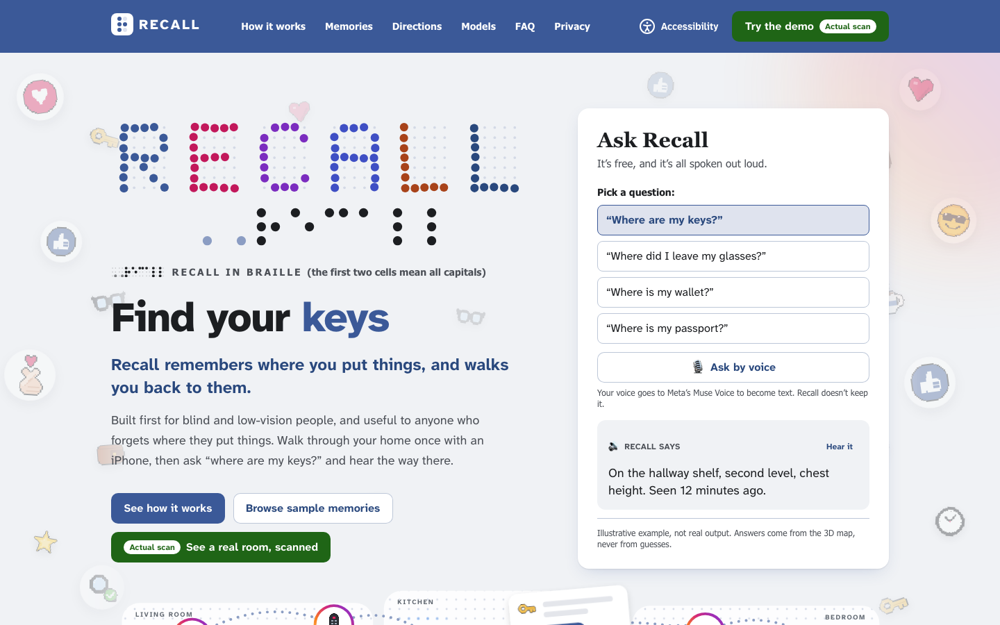
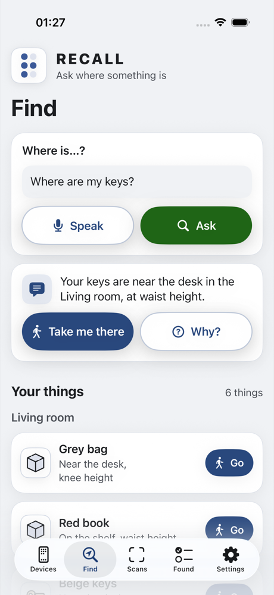
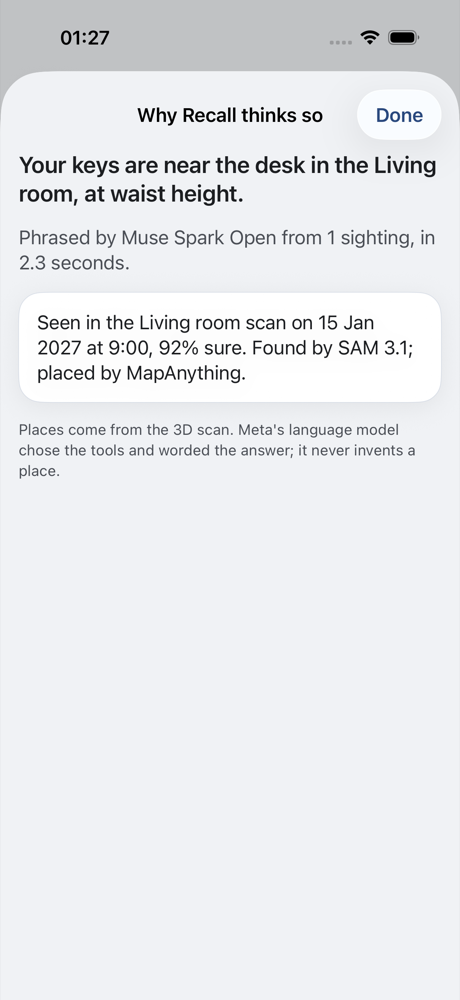
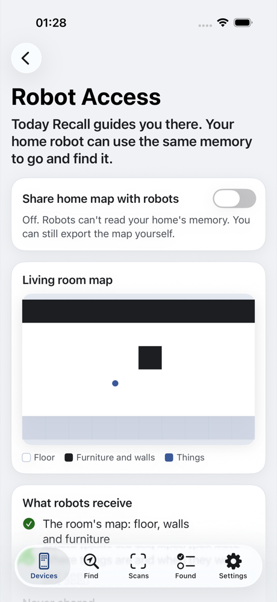
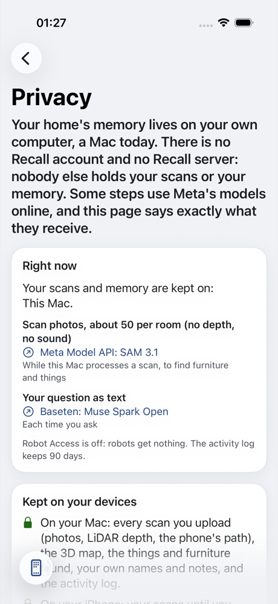

<p align="center">
  
</p>

<h1 align="center">RECALL</h1>

<p align="center"><strong>Recall remembers where you put things, and walks you back to them.</strong></p>

<p align="center"><em>“Where did I put my keys?”</em> · <em>“Have you seen my reading glasses?”</em><br>
<em>“Where's my grey bag?”</em> · <em>“Why do you think so?”</em></p>

<p align="center">…then tap <strong>Take me there</strong>, and the camera checks it's really there when you arrive.</p>

<p align="center"><strong>Built during the Meta Global AI Developer Hackathon, Oct 26 to Nov 4, 2026. Pre-existing work: none.</strong><br>
Indie track · Theme: <strong>Build for Your World</strong></p>

<p align="center">
  <a href="https://github.com/coder-RT/recall/actions/workflows/codeql.yml"></a>
  
  
  
  
  
  
  
</p>

<p align="center">
  
  
  
  
  
</p>

<p align="center">
  <a href="#3-backend-pipeline-and-demo">Try it (no keys)</a> ·
  <a href="#architecture-in-brief">Architecture</a> ·
  <a href="#api">API</a> ·
  <a href="docs/privacy.md">Privacy</a> ·
  <a href="#results-so-far">Results</a> ·
  <a href="https://www.linkedin.com/in/rachit-thariani/">LinkedIn</a> ·
  <a href="https://github.com/coder-RT">GitHub</a>
</p>

> What isn't finished yet is listed under [Not in this submission](#not-in-this-submission).

---

## Contents

1. [What it is](#what-it-is)
2. [What's in this repo](#whats-in-this-repo)
3. [Why I built it](#why-i-built-it)
4. [Recall's three agents](#recalls-three-agents)
5. [Sharing with robots](#sharing-with-robots)
6. [How it works: the Meta models](#how-it-works-the-meta-models)
7. [Architecture in brief](#architecture-in-brief)
8. [API](#api)
9. [Guardrails](#guardrails)
10. [Algorithms](#algorithms)
11. [Results so far](#results-so-far)
12. [How to run it](#how-to-run-it)
13. [Not in this submission](#not-in-this-submission)
14. [Contributing](#contributing)
15. [Built during the hackathon](#built-during-the-hackathon)
16. [Licence](#licence)

## Screenshots

No image of anyone's home is in this repo: the 3D viewer shows only a room you scan yourself.



The iPhone app, shown with sample data, not a real home:

<p align="center">
  
  
  
  
</p>

## What it is

**What**
- A voice-first 3D memory of your home for blind and low-vision people.
- Walk through a room once with an iPhone. Recall rebuilds the room in metres and remembers what it saw and where.
- Ask "where are my keys?" and hear the answer: which surface, which shelf level, how high, when it was last seen.
- Tap **Take me there** and get clock-face steps as you walk, and a camera check on arrival. Ask "why?" and hear what the camera saw. (Apple Watch taps are planned.)

**Why**
- Finding small things is a daily, tiring problem when you can't see where they are.
- Existing tools describe a single photo. They don't remember, and they don't walk you there.
- Independence and accessibility, not care: Recall is a memory and a guide, nothing medical.

**How**
- The iPhone records frames, LiDAR depth and ARKit poses, and leads the scan by voice, step by step: turn round, walk the walls, sweep the floor, close the loop. It measures how much floor and wall the LiDAR saw and whether ARKit's room map is ready, and says when to slow down, step back, add light or tilt down. Meta's MapAnything turns the frames into a metric 3D map; SAM 3.1 finds the furniture and objects in every frame.
- Geometry decides the facts (floor, surfaces, height bands, distances). Muse Spark Open, Meta's open model, understands the question, chooses the tools that look the facts up, and turns them into a short spoken answer.
- Recall's own three agents answer, verify and share; every model they call is a Meta model.

**Frameworks and stack**
- Web: Next.js 16, React 19, TypeScript, GSAP (scroll storytelling), Motion (UI), react-three-fiber (3D viewer).
- Backend: Python 3.12, FastAPI, SQLite, hexagonal architecture (ports and adapters) with DDD aggregates. How it fits together and why each piece was chosen over the alternatives: [docs/architecture.md](docs/architecture.md) and [docs/decisions.md](docs/decisions.md).
- Reconstruction pipeline: Python, MapAnything on the Mac's GPU, NumPy and SciPy for the geometry.
- iPhone: Swift 6, SwiftUI, ARKit, SceneKit, AVSpeechSynthesizer, Accelerate (the Apple Watch app is planned).
- Models: Meta Model API, Baseten (Muse Spark Open), Modal or LM Studio for open weights.

## What's in this repo

| What | Where | Status |
|---|---|---|
| iPhone app (Swift 6, SwiftUI, ARKit; VoiceOver first) | `apps/ios` (build with XcodeGen) | Works on an iPhone with LiDAR, iOS 26 |
| The API on your computer: the Guide, the arrival check, memory, privacy, robots | `services/api` | Works (`make live`) |
| The pipeline: 3D reconstruction, furniture and things, the room model | `services/pipeline` | Works (`make worker`) |
| A recorded real run you can try with no keys | `make demo` | Works; the recording is added after a privacy review |
| Website and 3D viewer of your own scan | `apps/web` | Works (`pnpm dev`) |
| API spec (OpenAPI 3.1, Swagger UI) and the A2A Agent Card | `services/api/resources/` | See [API](#api) |
| Architecture, decisions, privacy note, measurements | [`docs/`](docs) | [architecture](docs/architecture.md) · [decisions](docs/decisions.md) · [privacy](docs/privacy.md) · [verification](docs/verification.md) |
| Tests and CI: API, pipeline, website, iPhone (unit, integration, accessibility, usability) | `services/*/tests`, `apps/web/e2e`, `apps/ios/RecallUITests`, `.github/workflows` | Green |
| A usability session plan for a blind or low-vision tester | `evals/usability/` | Ready |
| The 3-minute demo video | | Coming |

## Why I built it

- The question "where did I put my keys?" is asked in every home, and for someone who is blind or has low vision it can end a morning.
- A home barely changes; what moves are the small things. That calls for a memory of the space, not a smarter camera.
- The pieces now exist as open Meta models: metric 3D from photos (MapAnything), find anything by name (SAM 3.1), a language model that can call tools and phrase a short spoken answer (Muse Spark Open / Glimmer).
- I wanted the result measured on real objects in a real flat, with the numbers published, rather than demonstrated on slides.

## Recall's three agents

These are Recall's own parts. Each one runs only Meta models.

- **Guide** is the only agent on the live question path. It understands the question, chooses among five tools (`find_object`, `describe_location`, `localize`, `plan_route`, `explain`) and words the answer. It never states a place, distance or time that no tool returned. The phone says "Looking for your keys." as soon as it has the question; the Guide's answer follows in 2.3 s (median of 10 real questions, one tool call each, Muse Spark Open at low reasoning effort; `docs/verification.md`).
- **Verifier** runs once, on arrival: one camera frame, SAM 3.1 plus the LiDAR depth, and a yes or no on whether the object is really there. Muse Spark 1.1 can only lower confidence. If it's found nearby, memory moves it there; if it isn't there, Recall says so plainly. The Guide calls it in-process by default and in the live demo; A2A between the two is optional.
- **Home Memory** answers a robot or another app you connect (a pair of glasses, another assistant) over the open A2A 1.0 protocol: read-only, off by default, never the user's live position. It accepts only structured input (one object name, checked against a schema), and a Meta model (Muse Spark Open, or Glimmer) checks that name before any tool runs. Every request is in the owner's audit log.
- One rule: every agent has a job no other agent does. Complexity is not the goal; the three jobs are different.

## Sharing with robots

A home robot can use the same memory to go and find something. Recall finds it on the map; picking it up is the
robot's own skill.

A robot, or any other app you connect, is a separate system that *asks* Recall a question. Recall answers it but never
runs its software or its models; every model Recall itself calls is a Meta model.

- **Off by default.** The owner turns it on in the app (Devices → Home robots → Robot Access); the switch is kept on
  the Mac. Robots use their own read-only key (`RECALL_ROBOT_KEY`), never the phone's.
- **Robot export** (`GET /homes/{home_id}/robot-export`, `make robot-export`, or "Export map for robots" on the phone as
  a .zip):
  - `map.pgm` + `map.yaml` for the Nav2 map server (the PGM is tested to read back the way Nav2 reads it);
  - `objects.json`: things in the map frame, with when each was last seen;
  - `room.json`: walls and furniture;
  - `cloud.ply`: the points (from the API).
- **Home Memory agent** over A2A 1.0 at `/a2a/home-memory`, with its Agent Card at
  `/a2a/home-memory/.well-known/agent-card.json`. Send `{"object": "keys"}` and get the room, the landmark, the
  position in the map frame and when it was last seen. The request is checked against a schema, then by Muse Spark
  Open, before any tool runs, and it fails closed.
- **What robots receive:** the map, things, furniture and last seen. **Never:** photos, your own names or notes for
  things, or anyone's position.
- **On record:** every robot request is in the owner's audit log, and the phone shows recent robot activity.
- **Scope today:** the export follows Nav2's map format, but no physical robot has been tested yet. A ROS 2 example
  skill is in progress and not in this submission.

## How it works: the Meta models

**Every model called at runtime is a Meta model.**

| Model | Job | Runs on | Code |
|---|---|---|---|
| Muse Spark Open (`meta-models/muse-spark-open-1026`) | Guide agent: understands the question, chooses the tools, words the answer (default) | Baseten | `services/api/.../adapters/outbound/llm/` |
| Muse Glimmer | Guide agent alternative; local privacy mode | Modal / Fireworks; LM Studio on the Mac | same adapter |
| Muse Spark (hosted) | Guide fallback | Meta Model API | same adapter |
| Muse Spark 1.1 (multimodal) | Verifier tie-break; may only downgrade a result, never confirm | Meta Model API | `services/api/.../adapters/outbound/vision/spark_vision_meta_api.py` |
| SAM 3.1 | Objects and furniture in every frame, by text prompt; the arrival check | Meta Model API (optional self-hosted on Modal) | `services/pipeline/.../sam31_meta_api.py`, `services/api/.../sam31_meta_api.py` |
| MapAnything (`facebook/map-anything-apache`) | Metric 3D reconstruction from the frames, depth and poses | Mac (Apple GPU); Modal if too slow | `services/pipeline/.../mapanything_local.py` |
| Muse Voice Transcribe | Speech to text with turn detection | Meta Model API | `services/api/.../voice/muse_transcribe.py`, `apps/web/app/api/voice/transcribe/` |
| Muse Spark Open (or Muse Glimmer) as a screen | Checks the object name a robot or outside app sends the home memory, after the schema; strict JSON verdict, fails closed | Baseten (LM Studio for Glimmer) | `services/api/.../safety/meta_model_screen.py` |

**The scan path** (minutes, in the background)
1. The iPhone walks the room and records keyframes, LiDAR depth and ARKit poses as an episode.
2. The episode uploads in resumable parts; the manifest arrives last and triggers the pipeline.
3. MapAnything rebuilds the room in metres, fed the phone's intrinsics, poses and depth.
4. The pipeline fits the floor and walls, and SAM 3.1 finds furniture (sofa, table, shelf, tv, bed, door) and objects.
5. Each find is lifted into 3D and stored as a landmark or an observation, with the time it was seen.

**The question path** (live, about 2 seconds)
1. The phone sends a spoken question to the Mac, and Muse Voice Transcribe turns it into text (typed questions skip this).
2. The phone says what it is looking for at once ("Looking for your keys.").
3. The Guide calls `find_object`, which returns each match with its room, landmark, relation ("on the desk"), shelf level, height band and when it was seen; one call usually answers. The answer is logged with the sightings behind it, and **Why?** reads them out.
4. **Take me there**: `localize` from the phone's ARKit pose, `plan_route` over an occupancy grid, clock-face steps spoken as you walk.
5. On arrival the Verifier checks the camera frame; if the thing is nearby, memory moves it.

**OS and browser features (not model calls)**

| Feature | Used for | Where |
|---|---|---|
| LiDAR depth, ARKit tracking, ARWorldMap | Capture in metres; relocalisation for live guidance | iPhone |
| ARKit poses, compass (magnetic north, no location) | Speed and turn rate for scan coaching come from the ARKit poses; the scan learns where north lies in the room, so directions can say "north-east" | iPhone |
| Haptics | Turn and arrival cues | iPhone (Apple Watch planned) |
| VoiceOver, Dynamic Type | The app is usable without looking | iPhone |
| AVSpeechSynthesizer | Speaking answers and steps | iPhone |
| Web Speech `speechSynthesis` | Every spoken line on the website | Browser |
| Action button, Digital Crown (planned) | Start listening; repeat the last step | iPhone, Watch |
| SceneKit | The arrow over the thing in the camera view, for a sighted helper | iPhone |
| WebGL | The 3D viewer | Browser |

## Architecture in brief

- **Phone captures, your computer remembers.** The iPhone records frames, LiDAR depth and ARKit poses and uploads them
  in resumable parts. A queue runs the pipeline one room at a time, and one API serves the phone, the website and
  robots.
- **Geometry decides; Meta's models understand, see, map and listen.** Places, heights and distances come from the 3D
  map. Muse Spark Open chooses the tools and words the answer, SAM 3.1 finds things, MapAnything builds the map, and
  Muse Voice Transcribe listens.
- **One writer.** Only the API writes memory; the pipeline posts its results.
- **Hexagonal, enforced in CI.** The domain and use cases never import a framework or a model client, so each Meta
  model or store is swapped by config.
- **Every answer is traceable, and your memory stays on your own computer.**


More: [docs/architecture.md](docs/architecture.md) (every layer, both paths, latency tiers, why each choice) ·
[docs/decisions.md](docs/decisions.md) (28 decisions, each with what was rejected) · [docs/privacy.md](docs/privacy.md)
· [docs/verification.md](docs/verification.md) (every measurement, dated).

## API

Spec-first: [`services/api/resources/openapi.yaml`](services/api/resources/openapi.yaml) (OpenAPI 3.1) is the source of
truth. The server's models and the iPhone's Swift client are generated from it, and contract tests check that the
routes match it. While `make demo` or `make live` runs, **Swagger UI** is at `http://localhost:8000/docs`.

| Route | What it does |
|---|---|
| `POST /ask` | Ask where something is; the answer comes with an `answer_id` |
| `GET /answers/{answer_id}/evidence` | Why: the tool steps, the sightings, their scans and the models behind an answer |
| `POST /transcribe` | Speech to text through Muse Voice Transcribe |
| `POST /scans`, `PUT /scans/{scan_id}/parts/{part_number}`, `POST /scans/{scan_id}/complete` | Resumable scan upload |
| `DELETE /scans/{scan_id}` | Erase a scan from your computer, with what only it found |
| `GET /homes/{home_id}/objects`, `GET /homes/{home_id}/room` | What Recall found, and the room model |
| `POST /guidance/sessions`, `POST /guidance/sessions/{session_id}/verify` | Directions, and the arrival check |
| `GET /privacy`, `GET /audit` | What is sent where right now; who did what |
| `GET /homes/{home_id}/robot-export`, `/a2a/home-memory` | For robots: the Nav2 map, and the Home Memory agent ([Agent Card](services/api/resources/agents/home-memory.card.json)) |

Every route except `/health` needs a key: the owner's device key, or a robot's own read-only key for the robot routes. The Agent Card is public while Robot Access is on, as A2A expects, so agents can discover it.

## Guardrails

- **Geometry decides, the model phrases.** No location, distance or time is ever inferred by a language model; they come from tool results computed on the 3D map.
- **Grounding rules, in the prompt and enforced in code:**
  1. Never state a place, distance or time that no tool returned.
  2. Not found, or confidence under 0.5: say it hasn't been seen and suggest which room to walk.
  3. A sighting older than 24 hours is reported with its time.
  4. If tracking is limited, give landmark directions only, and say so.
  5. One or two short sentences: landmark first, then shelf and height, then time.
  6. At most 6 agent steps; on failure, the best grounded partial answer.
- **Every answer is traceable.** Sightings are append-only. Every answer is logged with its model and tool steps and the sightings it rests on, and **Why?** on the phone (or `GET /answers/{answer_id}/evidence`, or asking the Guide "why?") leads back to the camera's view, the scan and the models that made it. An answer that names a place with no sighting behind it is never said.
- **The Verifier can only downgrade.** The vision model may turn a result into "uncertain"; only SAM plus geometry can confirm.
- **Two checks on the door.** A robot or outside app can send only one object name (letters, digits, spaces and hyphens, at most 40 characters, `services/api/resources/agents/find-object.input.schema.json`); free text is refused and never reaches a model or a tool. Then Muse Spark Open (or Glimmer) must answer `{"verdict": "safe", ...}` in strict JSON; anything else, a timeout or "injection" refuses. Measured: 21 ordinary names allowed, 18 instruction-like names refused, none wrong.
- **Privacy.** The home's memory lives on the owner's own computer (a Mac today); there is no Recall server. Scan photos go to SAM 3.1 on the Meta Model API, voice clips to Muse Voice Transcribe, and questions (no photos) to Muse Spark Open, or stay on the Mac with Glimmer in private mode. Deleting a scan on the phone erases it from the Mac too. No scan of anyone's home is in the repo or on the hosted site. Full note: [docs/privacy.md](docs/privacy.md), the same as the app's Settings → Privacy and the site's `/privacy`.
- **Honesty.** Sample and recorded data are labelled as such in the UI and the docs; the demo shows only what was built.
- **Rules.** Only Meta models at runtime; no non-Meta model anywhere, and no TTS model of any kind.

## Algorithms

- **Keyframe selection:** a frame is kept when the phone moved about 15 cm or turned about 10°; blurry frames are dropped by a sharpness check.
- **Pose convention:** ARKit camera-to-world poses are converted to the OpenCV convention MapAnything expects (`T @ diag(1, −1, −1, 1)`), unit tested.
- **Metric reconstruction:** MapAnything with the phone's intrinsics, poses and LiDAR depth as metric inputs, so the map is in metres and in the phone's own frame. `RECONSTRUCTOR=arkit_depth` skips the model and back-projects the LiDAR depth with the ARKit poses: on our living room every object landed within 7 cm of the MapAnything run (`docs/verification.md` 8b).
- **Drift check:** a Umeyama similarity transform between ARKit and MapAnything camera centres measures drift, and aligns images-only runs when phone data is missing.
- **Room model:** RANSAC plane fitting for the floor and the walls, deterministic and seeded; furniture from SAM 3.1 text prompts, lifted into 3D boxes.
- **Flat surfaces:** a height histogram of the point cloud, peaks grouped into connected patches on a 5 cm grid, thin lines rejected by fill ratio. This is what finds desk tops, seats and shelf levels.
- **Spatial relations:** "on" (within 5 cm of a surface and inside its footprint), left or right of a landmark's front, nearest landmark within 1.5 m, and five height bands (floor, knee, waist, chest, head).
- **What changed:** a rescan matches each kind of thing with the room's last scan by optimal assignment on 3D distance; moved more than 30 cm, new, or gone is decided by geometry, and things outside the rescan's view are left alone.
- **Navigation:** an occupancy grid at 10 cm from the point cloud, obstacles widened by a 0.3 m body radius and paths kept to the middle of free space, A* to a reachable cell near the object, simplified to turns and spoken as clock-face steps. A gap too narrow gives "no safe path" and landmark directions instead.
- **Arrival check:** SAM 3.1's box in one camera frame, lifted to 3D with the LiDAR depth; within 30 cm of the remembered place is confirmed.
- **Viewer:** voxel downsampling to about 150k points; a vertex shader that gathers every point from a scattered shell to its real position, floor first.

## Results so far

Measured, dated, and recorded in `docs/verification.md`. Nothing below is estimated.

- **Reconstruction speed (M5 Pro, Apple GPU):** one room, 63 frames from a 21-second phone video, MapAnything with the Apache-2.0 weights: **19.6 s** of inference, **14.8 GB** peak memory, 11.3 s to load the model.
- **Scale, images only:** two tape-measured desks (78 cm and 61 cm) came out about **23 % too large**, both by the same factor, so the shape is right and the absolute scale is not. This is why the pipeline feeds the phone's depth and poses into MapAnything. The tape-measured 20 cm check with the phone's inputs is still open.
- **Room processing:** **60 s** per room with the warm model server (143 s before it), on the M5 Pro.
- **Without a model:** LiDAR depth back-projected with the ARKit poses put all 10 objects of the living room within **2 to 7 cm** of the MapAnything run, in **0.2 s**.
- **Answer time:** the Guide on Muse Spark Open answers in **2.3 s** median, **2.7 s** p90 (10 real questions, one tool call each); the phone speaks an acknowledgement at once.
- **Arrival check:** on the real keys, SAM 3.1 plus the LiDAR depth put them **3 cm** from the remembered place, in **4.9 s**.
- **Robot screening:** **21** ordinary object names allowed and **18** instruction-like names refused, none wrong.
- **Cost, measured:** a room scan is **456** SAM 3.1 calls and **48 MB** on disk; a question is **2** Muse Spark Open calls, about **2,460 + 261 tokens**.
- **Flat surfaces:** the geometry-only detector found **12 level patches** in the room; the two largest sit at the heights of the two measured desks.
- **Viewer:** about 150k points, the gather animation, photo and confidence colouring, and the floor grid, height bands and surfaces as layers, on a phone and a laptop.
- **Tests:** API 140, pipeline 45 (including a synthetic room run through the whole pipeline), website 143 (accessibility with axe, WCAG 2.2 AA, reduced motion, no-JavaScript, and keyboard-only and 200 % text usability); on the iPhone, accessibility audits and usability tasks done with VoiceOver labels at default and largest text.

**Planned evaluation:** median position error against hand-measured positions, questions answered correctly, Verifier precision, and time to find an object by touch versus with Recall, scored without AI; the dated table will live in `evals/results.md`. The session plan for a blind or low-vision tester is in `evals/usability/`.

## How to run it

**Status today:** the website, the 3D viewer, the backend, the pipeline and the iPhone app all run. The Apple Watch app is planned.

### 1. The landing page and the 3D viewer (runs now)

- Requirements: Node 22 and pnpm (`corepack enable`).
- Install and start:
  ```bash
  pnpm install
  cd apps/web
  pnpm dev
  ```
- Open:
  - `http://localhost:3000/` for the landing page;
  - `http://localhost:3000/homes/flat/viewer` for your own scanned home (`flat` is the app's default home name); until it has a scan, the page lists the steps (section 2).
- Optional: "Ask by voice" on the landing page calls Muse Voice Transcribe through a server route. Create `.env` in the repo root with `META_MUSE_API_KEY=<your key>`; without it the card still works with the preset questions. Every spoken line on the site is the browser's own voice.
- Checks:
  ```bash
  pnpm lint && pnpm exec tsc --noEmit && pnpm build
  pnpm exec playwright test        # the browser suite; starts the dev server if needed
  ```

### 2. See your own room in the viewer

- Scan a room with the iPhone app and upload it to your Mac (`make live` runs the API and the scan worker; the steps are on the viewer page). The worker keeps MapAnything loaded (`recall-pipeline serve`, freed after 10 minutes idle) and starts loading it as soon as an upload begins; SAM 3.1 runs alongside the reconstruction, so a new room is ready in about a minute.
- Export the home's newest processed scan, then open `http://localhost:3000/homes/flat/viewer`:
  ```bash
  make viewer HOME_ID=flat
  ```
- Output: `apps/web/public/local-scan/<home>/` (points, photo colours, confidence, the room model and what Recall found). Git ignores the folder, so your room never leaves your computer.
- The viewer's **View** switch shows the room five ways, all computed from the scan's measurements (no generative model):
  - **Dots:** every measured point.
  - **Room model:** furniture as boxes coloured by kind, things at their measured size and colour.
  - **Surface:** the points joined into one coloured surface (Poisson reconstruction, Open3D).
  - **Photo room:** that surface painted with the scan's own photos, each patch from the photo that saw it best (checked against LiDAR depth so nothing behind a chair is painted onto it).
  - **Architect:** the room regenerated as an architect would draw it: walls squared to the room's main direction, walls the scan never saw marked as such, furniture rebuilt as parametric parts (a desk is a top on four legs) at its measured size and colour.
- Under the viewer, **Drawings** has A3 sheets drawn from the same data: a dimensioned floor plan (A1.1) and the walls seen square on from the scan's points (A2.1). The algorithms are in `services/pipeline/src/recall_pipeline/domain/` (`architecture.py`, `drawings.py`, `texturing.py`).

### 3. Backend, pipeline and demo

- `make setup`: Python 3.12 with uv, both services, the web app.
- `make demo`: no keys, no GPU. Builds a memory from a recorded real scan (`samples/replay/`, geometry and labels only, no photos) through the real ingest code, then serves the API on `localhost:8000` with Muse Spark Open's recorded replies; every answer is labelled `replay:muse-spark-open (recorded)`, and the command prints questions to try. `make record` re-records it with real calls.
- `make live`: the API and the scan worker (`make worker` alone starts the worker: the warm pipeline server plus the job queue), with real Meta model calls using the keys from `.env`. The minimum is one Meta Model API key from [dev.meta.ai](https://dev.meta.ai) with `LLM_PROVIDER=meta`; the demo video uses Muse Spark Open on Baseten (`LLM_PROVIDER=baseten_spark_open`); the local privacy mode uses Muse Glimmer in LM Studio (`LLM_PROVIDER=lmstudio`).
- **Home Memory agent (A2A) with `make live`:** its check runs on Muse Spark Open with the Baseten key (`SCREEN_PROVIDER=baseten_spark_open`, the default) or on Glimmer in LM Studio (`SCREEN_PROVIDER=lmstudio`); no other key is needed.
- `make test`, `make lint`, `make lint-imports`: tests, ruff and ESLint, and the architecture rule (domain ← application ← adapters).

### 4. iPhone app (Watch planned)

- XcodeGen generates the project (`cd apps/ios && xcodegen generate`); it needs an iPhone with LiDAR running iOS 26 and a free Apple ID for signing.
- In the app's Settings, enter the Mac's address (the API on your network, a Tailscale HTTPS address or a Cloudflare Tunnel URL) and the device key from `.env`. No other keys live on the phone.
- Tabs:
  - **Devices** (first; the app still opens on Find): where Recall runs. The iPhone is available now; Apple Watch Ultra 4 support is coming next and Meta AI glasses are planned, each labelled as such. **Home robots → Robot Access**: the switch, what robots receive and never receive, a map preview, the export, and recent robot activity. **Your privacy** opens the privacy note.
  - **Find**: ask "where are my keys?" by typing or speaking (Muse Voice Transcribe on the Mac), hear the answer, then **Why?** (the sightings behind it, read aloud) or **Take me there**. The phone relocalises in the saved room map, the Mac plans a route, and the phone speaks clock-face turns with the compass point and distance ("At 2 o'clock, north-east, 3 metres"), with a tick when you face the right way and a blue arrow over the thing in the camera view for a sighted helper. Without a map match it says the landmark and which way it lies, and ticks when you face it.
  - **Scans**: record a room, led by voice, with a step card, a top-down mini-map and the room-map state on screen; then upload it. **Scan again** compares the room with its last scan and says what moved, what's new and what's gone. Deleting a scan asks first, then erases it from the iPhone and the Mac.
  - **Found**: what Recall found, grouped by room and furniture with an icon for each kind of thing; correct the name, colour or height, or forget a thing.
  - **Settings**: **Privacy** (what stays home and what is sent where, read live from the Mac), the Mac's address and key, and Appearance (automatic, light or dark, plus high contrast in black, white and yellow).

### 5. Hosted version (optional)

- If a hosted copy is linked at submission, it runs in replay mode: no account and no keys needed.
- Everything also runs locally from the steps above.

### 6. Environment variables

- Keys live in `.env` at the repo root, which is never committed: `META_MUSE_API_KEY` (Meta Model API), `BASETEN_API_KEY` (Muse Spark Open on Baseten) and `RECALL_DEVICE_KEY` (any long random string; the phone pairs with it).
- `make demo` needs none. `make live` needs the Meta Model API key and, for the demo setup, the Baseten key; the Glimmer, LM Studio, A2A and R2 settings are optional.
- Optional: `RECALL_ROBOT_KEY` (robots' own read-only key), `SCREEN_PROVIDER` (`baseten_spark_open` or `lmstudio`), `GUIDE_REASONING_EFFORT` (default `low`), `RECONSTRUCTOR` (`mapanything` or `arkit_depth`).

## Not in this submission

Planned next, not built or not working yet (updated before submission; removed if everything works):

- The Apple Watch app (taps and Digital Crown repeat) and Meta AI glasses.
- The ROS 2 robot example skill (in progress).
- The tape-measured 20 cm accuracy check with the phone's depth and poses.
- Quantitative evaluations and the Verifier precision figure.
- The usability session with a blind or low-vision tester (plan ready in `evals/usability/`).
- Daily spend caps on model calls (today only the website's voice route is rate-limited).
- The 3-minute demo video.

## Contributing

- Recall is a solo entry in the Meta Global AI Developer Hackathon (Indie track); pull requests open after the results on Nov 9, 2026.
- After that, issues and pull requests are welcome. Please:
  1. read `CLAUDE.md` (rules, architecture, conventions);
  2. keep the dependency rule: domain code imports nothing from adapters or frameworks;
  3. use Conventional Commits, small and frequent;
  4. keep `make test`, `make lint` and the Playwright suite green;
  5. never commit secrets, raw walkthrough video or anything personal from a scan.

## Built during the hackathon

- Everything in this repo was built from scratch during the event. The repo was created on Oct 26, 2026, the day the hackathon began, after its kickoff.
- There is no prior work, no imported code and no earlier history; `PRIOR_WORK.md` says None.
- The commit history is the evidence of when each part was built.
- Third-party libraries and models are dependencies, never copied in; each is listed with its licence in `THIRD_PARTY.md`.

## Licence

- This repository: Apache-2.0 (see `LICENSE`).
- Models, libraries, fonts and services, each with its licence: `THIRD_PARTY.md`.
- Recall is not affiliated with or endorsed by Meta.

---

<p align="center">Built by <a href="https://www.linkedin.com/in/rachit-thariani/">Rachit Thariani</a> · <a href="https://github.com/coder-RT">GitHub</a></p>
