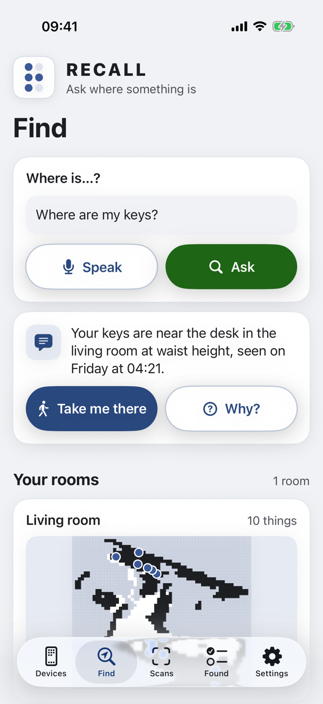
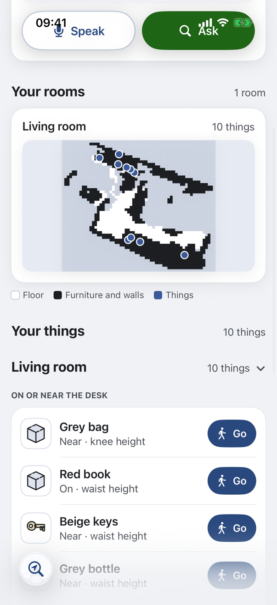
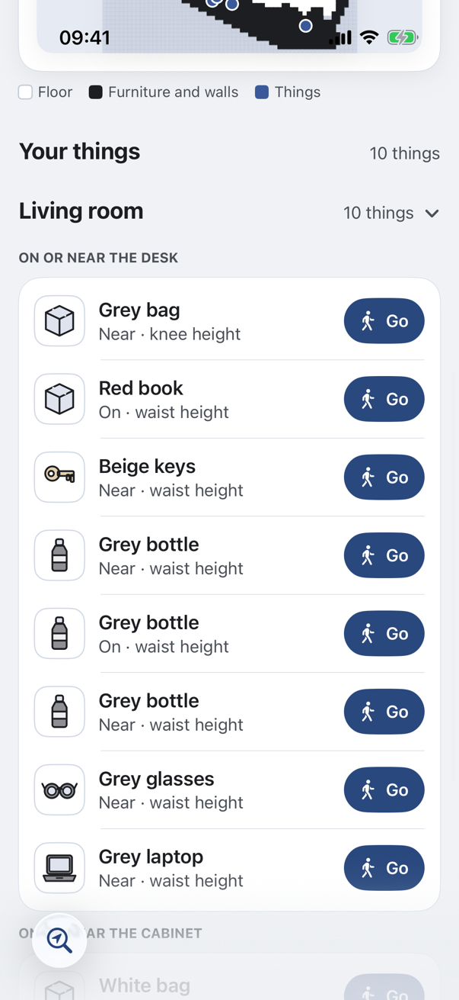
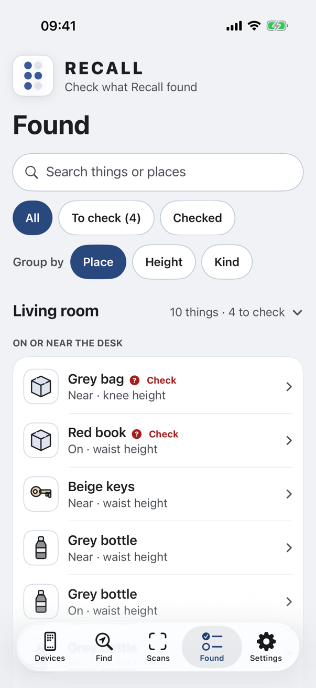
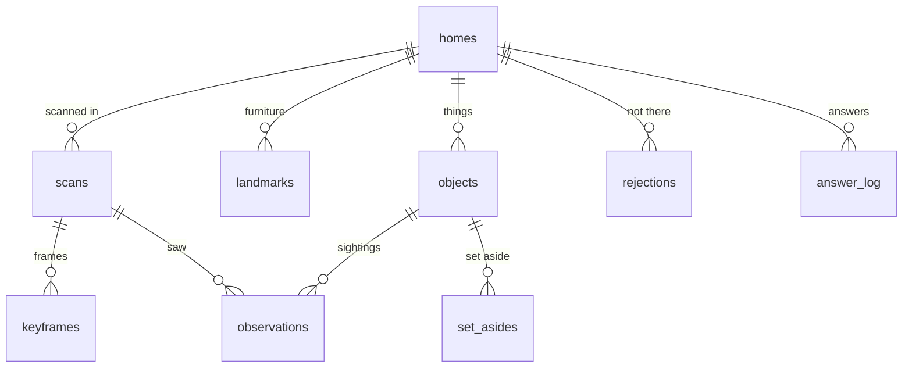

<p align="center">
  
</p>

<h1 align="center">RECALL</h1>

<p align="center"><strong>Recall remembers where you put things, and walks you back to them.</strong><br>
Built first for blind and low-vision people, useful to anyone who misplaces things.</p>

<p align="center"><strong>LiDAR + Meta models:</strong> the iPhone's LiDAR measures, Meta's MapAnything builds the 3D map,
SAM 3.1 finds your things in it, and Muse Voice Transcribe + Muse Spark Open hear the question and answer it.<br>
<a href="docs/privacy.md">Private</a> · <a href="#guardrails">Never guesses</a> · <a href="#what-it-is">Voice-first</a></p>

<p align="center">
  <em>“Where did I put my keys?”</em><br>
  <em>“Have you seen my reading glasses?”</em><br>
  <em>“Where's my grey bag?”</em><br>
  <em>“Why do you think so?”</em>
</p>

<p align="center">…then tap <strong>Take me there</strong>, and the camera checks it's really there when you arrive.</p>

<p align="center"><strong>Built during the Meta Global AI Developer Hackathon, Oct 26 to Nov 4, 2026. Pre-existing work: none.</strong><br>
Indie track · Theme: <strong>Build for Your World</strong></p>

<p align="center">
  <a href="https://github.com/coder-RT/recall/actions/workflows/codeql.yml"></a>
  
  
  
  
  
  
  
</p>

<p align="center">
  
  
  
  
  
  
</p>

<p align="center">
  <a href="#3-backend-pipeline-and-demo">Try it (no keys)</a> ·
  <a href="#architecture-in-brief">Architecture</a> ·
  <a href="#api">API</a> ·
  <a href="docs/privacy.md">Privacy</a> ·
  <a href="#results-so-far">Results</a> ·
  <a href="https://www.linkedin.com/in/rachit-thariani/">LinkedIn</a> ·
  <a href="https://github.com/coder-RT">GitHub</a>
</p>

> What isn't finished yet is listed under [Not in this submission](#not-in-this-submission).

<br>

<div align="center">

| **2.3 s** | **3 cm** | **60 s** | **2–7 cm** | **0** |
|:---:|:---:|:---:|:---:|:---:|
| from question to answer,<br>median of 10 real questions | arrival check on the real keys,<br>SAM 3.1 + LiDAR depth | to rebuild a room in 3D<br>on a Mac (M5 Pro) | where a no-model rebuild put<br>all 10 things vs MapAnything | non-Meta models<br>at runtime |

<sub>Every number is measured and dated in <a href="docs/verification.md">docs/verification.md</a>; see <a href="#results-so-far">Results so far</a>.</sub>

</div>

<br>

### For judges, in one minute

| Criterion | Where to look |
|---|---|
| **Impact** (30 %) | [Why I built it](#why-i-built-it): a true story · [What it is](#what-it-is): built first for blind and low-vision people, for anyone who misplaces things, voice first · [Privacy](docs/privacy.md): the home stays on your own computer · the [tester session plan](evals/usability/) |
| **Use of Meta AI tooling** (25 %) | [Only Meta models, each with one job](#how-it-works-the-meta-models): MapAnything, SAM 3.1, Muse Spark Open (Muse Glimmer on your own Mac), Muse Voice Transcribe, Muse Spark 1.1 · [Recall's three agents](#recalls-three-agents) · [Sharing with robots](#sharing-with-robots) over A2A |
| **Demo** (25 %) | The screenshots below are real output · `make demo` replays a real run with no keys · [How to run it](#how-to-run-it) |
| **Technical depth** (20 %) | [Architecture](docs/architecture.md) · [28 decisions](docs/decisions.md) · [Guardrails](#guardrails): geometry decides the facts, the model only phrases them · [Algorithms](#algorithms) · tests on every part ([Results so far](#results-so-far)) |

---

## Contents

1. [What it is](#what-it-is)
2. [What's in this repo](#whats-in-this-repo)
3. [How the code is laid out](#how-the-code-is-laid-out)
4. [Why I built it](#why-i-built-it)
5. [Meta Muse in the code](#meta-muse-in-the-code)
6. [Recall's three agents](#recalls-three-agents)
7. [Built with Muse Code: three tiers of agents](#built-with-muse-code-three-tiers-of-agents)
8. [Sharing with robots](#sharing-with-robots)
9. [How it works: the Meta models](#how-it-works-the-meta-models)
10. [Architecture in brief](#architecture-in-brief)
11. [API](#api)
12. [Guardrails](#guardrails)
13. [Security and privacy](#security-and-privacy)
14. [Data model](#data-model)
15. [Algorithms](#algorithms)
16. [Results so far](#results-so-far)
17. [Installation](#installation)
18. [How to run it](#how-to-run-it)
19. [Not in this submission](#not-in-this-submission)
20. [Contributing](#contributing)
21. [Built during the hackathon](#built-during-the-hackathon)
22. [Licence](#licence)

## Screenshots

**Real output, from the author's own living room:** one walk with an iPhone, rebuilt on a Mac. The room map shows
floor, furniture and walls as cells, and the things as dots: no photos of the home are in this repo.

<table>
  <tr>
    <td width="33%" align="center"></td>
    <td width="33%" align="center"></td>
    <td width="33%" align="center"></td>
  </tr>
  <tr>
    <td><b>Ask.</b> Muse Spark Open picks the tools; the place comes from the 3D memory. <b>Take me there</b> walks you to it.</td>
    <td><b>Your rooms.</b> The map MapAnything and SAM 3.1 built from one walk. Swipe between rooms; tap one to see only its things.</td>
    <td><b>Why?</b> The sighting behind the answer, and which model worded it, in how long.</td>
  </tr>
  <tr>
    <td width="33%" align="center"></td>
    <td width="33%" align="center"></td>
    <td width="33%" align="center"></td>
  </tr>
  <tr>
    <td><b>Your things.</b> By room, then the furniture they're on or near. <b>Go</b> on every row.</td>
    <td><b>Found.</b> Check what the scan found; fix a name, colour or height; the unsure ones are marked.</td>
    <td><b>Robot Access.</b> Off by default. A robot gets the map and where things are, never photos or anyone's position.</td>
  </tr>
</table>


## What it is

**What**
- A voice-first 3D memory of your home for blind and low-vision people.
- Walk through a room once with an iPhone. Recall rebuilds the room in metres and remembers what it saw and where.
- Ask "where are my keys?" and hear the answer: which surface, which shelf level, how high, when it was last seen.
- Tap **Take me there** and get clock-face steps as you walk, and a camera check on arrival. Ask "why?" and hear what the camera saw. (Apple Watch taps are planned.)

**Why**
- Finding small things is a daily, tiring problem when you can't see where they are.
- Existing tools describe a single photo. They don't remember, and they don't walk you there.
- Independence and accessibility, not care: Recall is a memory and a guide, nothing medical.

**How**
- The iPhone records frames, LiDAR depth and ARKit poses, and leads the scan by voice, step by step: turn round, walk the walls, sweep the floor, close the loop. It measures how much floor and wall the LiDAR saw and whether ARKit's room map is ready, and says when to slow down, step back, add light or tilt down. Meta's MapAnything turns the frames into a metric 3D map; SAM 3.1 finds the furniture and objects in every frame.
- Geometry decides the facts (floor, surfaces, height bands, distances). Muse Spark Open, Meta's open model, understands the question, chooses the tools that look the facts up, and turns them into a short spoken answer.
- Recall's own three agents answer, verify and share; every model they call is a Meta model.

**Frameworks and stack**
- Web: Next.js 16, React 19, TypeScript, GSAP (scroll storytelling), Motion (UI), react-three-fiber (3D viewer).
- Backend: Python 3.12, FastAPI, SQLite, hexagonal architecture (ports and adapters) with DDD aggregates. How it fits together and why each piece was chosen over the alternatives: [docs/architecture.md](docs/architecture.md) and [docs/decisions.md](docs/decisions.md).
- Reconstruction pipeline: Python, MapAnything on the Mac's GPU, NumPy and SciPy for the geometry.
- iPhone: Swift 6, SwiftUI, ARKit, SceneKit, AVSpeechSynthesizer, Accelerate (the Apple Watch app is planned).
- Models: Meta Model API, Baseten (Muse Spark Open), Modal or LM Studio for open weights.

## What's in this repo

| What | Where | Status |
|---|---|---|
| iPhone app (Swift 6, SwiftUI, ARKit; VoiceOver first) | `apps/ios` (build with XcodeGen) | Works on an iPhone with LiDAR, iOS 26 |
| The API on your computer: the Guide, the arrival check, memory, privacy, robots | `services/api` | Works (`make live`) |
| The pipeline: 3D reconstruction, furniture and things, the room model | `services/pipeline` | Works (`make worker`) |
| A recorded real run you can try with no keys | `make demo` | Works; the recording is added after a privacy review |
| Website and 3D viewer of your own scan | `apps/web` | Works (`pnpm dev`) |
| API spec (OpenAPI 3.1, Swagger UI) and the A2A Agent Card | `services/api/resources/` | See [API](#api) |
| Architecture, decisions, privacy note, measurements | [`docs/`](docs) | [architecture](docs/architecture.md) · [decisions](docs/decisions.md) · [privacy](docs/privacy.md) · [verification](docs/verification.md) |
| Tests and CI: API, pipeline, website, iPhone (unit, integration, accessibility, usability) | `services/*/tests`, `apps/web/e2e`, `apps/ios/RecallUITests`, `.github/workflows` | Green |
| A usability session plan for a blind or low-vision tester | `evals/usability/` | Ready |
| The 3-minute demo video | | Coming |

## How the code is laid out

```
apps/
  ios/        RecallKit package (Domain, Application, Networking, Capture, Voice, Persistence, Design)
              + thin Recall (iPhone), RecallWatch and RecallUITests targets
  web/        Next.js: landing page, 3D viewer, voice demo route, Playwright tests (e2e/)
services/
  api/        FastAPI: domain/ → application/ → adapters/ + infra/ ; resources/ = the OpenAPI spec (source of truth)
  pipeline/   the scan pipeline, same layers: MapAnything, SAM 3.1, planes, merging, the room model
docs/         architecture, privacy, verification, Meta Muse (docs/muse.md)
evals/        questions, usability plan
```

- **Hexagonal (ports and adapters) in every service**: domain ← application ← adapters and infra.
  - *Why:* a Meta model, a store or a transport is swapped in one place (`infra/container.py`), and the domain is
    tested with no network.
  - *Kept honest by:* import-linter (4 contracts in CI) and `services/api/tests/unit/test_architecture.py`, which
    checks that routers only map and only use cases write the memory.
- **One writer**: only `services/api` writes the home's memory; the pipeline posts its result
  (`POST /scans/{id}/results`).
  - *Why:* no two processes can race on what Recall remembers.
- **Spec-first API**: `services/api/resources/openapi.yaml` is the contract. The API's Pydantic models and the
  iPhone's Swift client are generated from it.
  - *Why:* the phone and the Mac can't drift. Schemathesis checks the running API against the spec.
- **The iPhone app is a package plus thin targets**: all logic lives in RecallKit (pure Swift domain, use cases,
  adapters). The app, Watch and test targets only compose it.
  - *Why:* the logic is unit-tested without a device or simulator.
- **The web is two motion systems, never on one element**: GSAP owns scroll storytelling and Motion owns UI state.
  Reduced motion is respected by both.

**Tests, and where they live**

| Suite | Where | What it checks |
|---|---|---|
| API unit | `services/api/tests/unit` | Domain, use cases with fake adapters, architecture rules, request limits |
| API contract | `services/api/tests/contract` | Routes vs the spec, Schemathesis on every GET, `tools.json`, privacy notes in sync |
| API integration | `services/api/tests/integration` | SQLite + disk, scan to answer end to end |
| Pipeline | `services/pipeline/tests` | Geometry (planes, Umeyama, merging), the warm server's security |
| Web | `apps/web/e2e` | Every section, accessibility (axe, WCAG 2.2 AA), usability, security headers |
| iPhone unit | `apps/ios/Packages/RecallKit/Tests` | Domain, use cases, networking, capture |
| iPhone UI | `apps/ios/RecallUITests` | Accessibility audit of every screen, usability flows, pairing |

`make test-all` runs every suite under `caffeinate` and logs each run locally; CI runs on GitHub Actions.

## Why I built it

- I lose things too: keys, glasses, the charger. For me it's a few minutes of searching. For someone who is blind or has low vision it can mean searching by touch, or asking for help, every day.
- So Recall is designed for the hardest case first: no screen needed, voice in and out, directions you can follow with your eyes closed. Built that way, it's simply quicker for everyone (the curb-cut effect).
- A home barely changes; what moves are the small things. That calls for a memory of the space, not a smarter camera.
- The pieces now exist as open Meta models: metric 3D from photos (MapAnything), find anything by name (SAM 3.1), a language model that can call tools and phrase a short spoken answer (Muse Spark Open / Glimmer).
- I wanted the result measured on real objects in a real flat, with the numbers published, rather than demonstrated on slides.

## Meta Muse in the code

Muse models are the core of Recall's question path: they hear the question, choose the tools and speak the answer.
Geometry decides every fact; Muse turns facts into speech. Full detail: [docs/muse.md](docs/muse.md).

- **Muse Voice Transcribe hears the question**
  - *What:* speech to text, with turn detection (`ENDPOINTING`), so Recall knows when you've finished.
  - *Why:* Recall is voice-first, and this is the only speech model it uses (no Apple speech recognition).
  - *How:* the phone records WAV → the Mac sends it to the Meta Model API → only the words are kept, never the audio.
  - *Code:* `services/api/.../adapters/outbound/voice/muse_transcribe.py`, `application/transcribe_speech.py`
- **Muse Spark Open is the Guide**
  - *What:* understands "where are my keys?", calls Recall's tools and says one or two short sentences.
  - *Why:* it calls tools and phrases things naturally, with open weights. It never decides a place.
  - *How:*
    1. The question arrives with five tools (`resources/tools.json`).
    2. Spark Open picks `find_object`, and Recall answers it from the 3D map.
    3. Spark Open words it: landmark, then shelf and height, then when.
    4. The code checks that every place it says came from a tool (`domain/assistant`), within 6 steps at most.
  - *Code:* `application/ask_where_is.py`, `adapters/outbound/llm/openai_compatible.py`
- **Baseten serves Muse Spark Open**
  - *What:* Baseten hosts Meta's open-weights Muse Spark Open (`meta-models/muse-spark-open-1026`) behind an
    OpenAI-compatible endpoint (`https://inference.baseten.co/v1`) with tool calling.
  - *Used for:* the Guide (the default, `LLM_PROVIDER=baseten_spark_open`, at `reasoning_effort: low`) and the
    screen that checks what outside agents send (`SCREEN_PROVIDER=baseten_spark_open`).
  - *Why:* open weights served fast (a median 2.3 s from question to answer), on the hackathon's Baseten credit, and
    the Mac's memory stays free for MapAnything.
  - *How:* one `BASETEN_API_KEY` in `.env`; the same OpenAI-compatible adapter as every other Muse provider.
  - *Code:* `adapters/outbound/llm/openai_compatible.py`, `adapters/outbound/safety/meta_model_screen.py`
- **Muse Glimmer is private mode**
  - *What:* the same Guide, on Muse Glimmer in LM Studio on your Mac.
  - *Why:* your questions never leave home.
  - *How:* `LLM_PROVIDER=lmstudio`; same adapter, same tools.
- **Muse Spark 1.1 is the Verifier's second opinion**
  - *What:* looks at the arrival photo when SAM 3.1 is unsure.
  - *Why:* a wrong "it's here" is worse than "I'm not sure".
  - *How:* it can only lower a result to "uncertain", never confirm one.
  - *Code:* `application/verify_arrival.py`, `adapters/outbound/vision/spark_vision_meta_api.py`
- **Muse Spark Open (or Glimmer) screens outside agents**
  - *What:* checks the object name a robot or another app sends the Home Memory agent.
  - *Why:* outside text must never steer a model or a tool.
  - *How:* schema first (one name, at most 40 characters) → a strict JSON verdict → anything unclear is refused
    (fails closed).
  - *Code:* `adapters/outbound/safety/meta_model_screen.py`, `application/answer_external_query.py`
- **Recorded Muse replies make the demo work without keys**
  - *What:* `make demo` replays real Muse Spark Open replies to a real scan, labelled as recorded.
  - *Code:* `adapters/outbound/replay/recorded_llm.py`

## Recall's three agents

These are Recall's own parts. Each one runs only Meta models.

- **Guide** is the only agent on the live question path. It understands the question, chooses among five tools (`find_object`, `describe_location`, `localize`, `plan_route`, `explain`) and words the answer. It never states a place, distance or time that no tool returned. The phone says "Looking for your keys." as soon as it has the question; the Guide's answer follows in 2.3 s (median of 10 real questions, one tool call each, Muse Spark Open at low reasoning effort; `docs/verification.md`).
- **Verifier** runs once, on arrival: one camera frame, SAM 3.1 plus the LiDAR depth, and a yes or no on whether the object is really there. Muse Spark 1.1 can only lower confidence. If it's found nearby, memory moves it there; if it isn't there, Recall says so plainly. The Guide calls it in-process by default and in the live demo; A2A between the two is optional.
- **Home Memory** answers a robot or another app you connect (a pair of glasses, another assistant) over the open A2A 1.0 protocol: read-only, off by default, never the user's live position. It accepts only structured input (one object name, checked against a schema), and a Meta model (Muse Spark Open, or Glimmer) checks that name before any tool runs. Every request is in the owner's audit log.
- One rule: every agent has a job no other agent does. Complexity is not the goal; the three jobs are different.

## Built with Muse Code: three tiers of agents

Recall's three agents above run in the product. Separately, while building it, **Meta's Muse Code** (v1.4.14) tested
and audited the repository with agents of its own. Details and every finding: [docs/muse.md](docs/muse.md#part-b-how-muse-code-tested-recall).

```
 Tester ─┐
         ├─▶ Tie-breaker ─▶ Synthesis (the only writer)
Reviewer ┘
```

- **A workflow program spawns the agents**
  - Muse Code writes a small program: `host.parallel` runs agents side by side, and `host.agent` runs the next stage.
  - Results pass between stages as references, not files.
- **Every agent answers with evidence or "unresolved"**
  - Each claim carries a `path:line` and the test behind it. A search result alone doesn't count.
- **Tier 1: Tester and Reviewer, side by side**
  - The tester ran every suite three times, with an anti-loop rule: one attempt, then report "blocked" with the exact
    error.
  - The reviewer only read code: the hexagonal layers, the ports, the composition roots and the tests behind each.
- **Tier 2: Tie-breaker**
  - Took every disagreement and re-read the code to settle it, without running the tests again.
- **Tier 3: Synthesis**
  - The only agent that writes, so nothing is overwritten: the test report and a code, pipeline, UI and algorithm
    checklist.
- **The security audit used the same shape**
  - Backend, web and iPhone/Watch auditors ran side by side with no live attacks, then a synthesis wrote it up.
  - A camera-privacy review was done by Muse Code directly.
- **What it found, and what happened next**
  - A pipeline crash risk without an Apple GPU, a Watch that could wait forever, logic in routers, no Schemathesis,
    a silent pairing-link takeover, camera prompts that didn't name Meta's models, and missing rate limits.
  - Each was checked against the code and fixed. Commits are listed in [docs/muse.md](docs/muse.md#what-muse-code-found).
- **Where the tests ran**
  - Muse Code ran the API, pipeline, web and lint suites in its sandbox.
  - The iOS, Watch and network-server suites run on the Mac with `make test-all`, and every suite passes.

## Sharing with robots

A home robot can use the same memory to go and find something. Recall finds it on the map; picking it up is the
robot's own skill.

A robot, or any other app you connect, is a separate system that *asks* Recall a question. Recall answers it but never
runs its software or its models; every model Recall itself calls is a Meta model.

- **Off by default.** The owner turns it on in the app (Devices → Home robots → Robot Access); the switch is kept on
  the Mac. Robots use their own read-only key (`RECALL_ROBOT_KEY`), never the phone's.
- **Robot export** (`GET /homes/{home_id}/robot-export`, `make robot-export`, or "Export map for robots" on the phone as
  a .zip):
  - `map.pgm` + `map.yaml` for the Nav2 map server (the PGM is tested to read back the way Nav2 reads it);
  - `objects.json`: things in the map frame, with when each was last seen;
  - `room.json`: walls and furniture;
  - `cloud.ply`: the points (from the API).
- **Home Memory agent** over A2A 1.0 at `/a2a/home-memory`, with its Agent Card at
  `/a2a/home-memory/.well-known/agent-card.json`. Send `{"object": "keys"}` and get the room, the landmark, the
  position in the map frame and when it was last seen. The request is checked against a schema, then by Muse Spark
  Open, before any tool runs, and it fails closed.
- **What robots receive:** the map, things, furniture and last seen. **Never:** photos, your own names or notes for
  things, or anyone's position.
- **On record:** every robot request is in the owner's audit log, and the phone shows recent robot activity.
- **Scope today:** the export follows Nav2's map format, but no physical robot has been tested yet. A ROS 2 example
  skill is in progress and not in this submission.

## How it works: the Meta models

**Every model called at runtime is a Meta model.**

| Model | Job | Runs on | Code |
|---|---|---|---|
| Muse Spark Open (`meta-models/muse-spark-open-1026`) | Guide agent: understands the question, chooses the tools, words the answer (default) | Baseten | `services/api/.../adapters/outbound/llm/` |
| Muse Glimmer | Guide agent alternative; local privacy mode | Modal / Fireworks; LM Studio on the Mac | same adapter |
| Muse Spark (hosted) | Guide fallback | Meta Model API | same adapter |
| Muse Spark 1.1 (multimodal) | Verifier tie-break; may only downgrade a result, never confirm | Meta Model API | `services/api/.../adapters/outbound/vision/spark_vision_meta_api.py` |
| SAM 3.1 | Objects and furniture in every frame, by text prompt; the arrival check | Meta Model API (optional self-hosted on Modal) | `services/pipeline/.../sam31_meta_api.py`, `services/api/.../sam31_meta_api.py` |
| MapAnything (`facebook/map-anything-apache`) | Metric 3D reconstruction from the frames, depth and poses | Mac (Apple GPU); Modal if too slow | `services/pipeline/.../mapanything_local.py` |
| Muse Voice Transcribe | Speech to text with turn detection | Meta Model API | `services/api/.../voice/muse_transcribe.py`, `apps/web/app/api/voice/transcribe/` |
| Muse Spark Open (or Muse Glimmer) as a screen | Checks the object name a robot or outside app sends the home memory, after the schema; strict JSON verdict, fails closed | Baseten (LM Studio for Glimmer) | `services/api/.../safety/meta_model_screen.py` |

**The scan path** (minutes, in the background)
1. The iPhone walks the room and records keyframes, LiDAR depth and ARKit poses as an episode.
2. The episode uploads in resumable parts; the manifest arrives last and triggers the pipeline.
3. MapAnything rebuilds the room in metres, fed the phone's intrinsics, poses and depth.
4. The pipeline fits the floor and walls, and SAM 3.1 finds furniture (sofa, table, shelf, tv, bed, door) and objects.
5. Each find is lifted into 3D and stored as a landmark or an observation, with the time it was seen.

**The question path** (live, about 2 seconds)
1. The phone sends a spoken question to the Mac, and Muse Voice Transcribe turns it into text (typed questions skip this).
2. The phone says what it is looking for at once ("Looking for your keys.").
3. The Guide calls `find_object`, which returns each match with its room, landmark, relation ("on the desk"), shelf level, height band and when it was seen; one call usually answers. The answer is logged with the sightings behind it, and **Why?** reads them out.
4. **Take me there**: `localize` from the phone's ARKit pose, `plan_route` over an occupancy grid, clock-face steps spoken as you walk.
5. On arrival the Verifier checks the camera frame; if the thing is nearby, memory moves it.

**OS and browser features (not model calls)**

| Feature | Used for | Where |
|---|---|---|
| LiDAR depth, ARKit tracking, ARWorldMap | Capture in metres; relocalisation for live guidance | iPhone |
| ARKit poses, compass (magnetic north, no location) | Speed and turn rate for scan coaching come from the ARKit poses; the scan learns where north lies in the room, so directions can say "north-east" | iPhone |
| Haptics | Turn and arrival cues | iPhone (Apple Watch planned) |
| VoiceOver, Dynamic Type | The app is usable without looking | iPhone |
| AVSpeechSynthesizer | Speaking answers and steps | iPhone |
| Web Speech `speechSynthesis` | Every spoken line on the website | Browser |
| Action button, Digital Crown (planned) | Start listening; repeat the last step | iPhone, Watch |
| SceneKit | The arrow over the thing in the camera view, for a sighted helper | iPhone |
| WebGL | The 3D viewer | Browser |

## Architecture in brief

- **Phone captures, your computer remembers.** The iPhone records frames, LiDAR depth and ARKit poses and uploads them
  in resumable parts. A queue runs the pipeline one room at a time, and one API serves the phone, the website and
  robots.
- **Geometry decides; Meta's models understand, see, map and listen.** Places, heights and distances come from the 3D
  map. Muse Spark Open chooses the tools and words the answer, SAM 3.1 finds things, MapAnything builds the map, and
  Muse Voice Transcribe listens.
- **One writer.** Only the API writes memory; the pipeline posts its results.
- **Hexagonal, enforced in CI.** The domain and use cases never import a framework or a model client, so each Meta
  model or store is swapped by config.
- **Every answer is traceable, and your memory stays on your own computer.**


More: [docs/architecture.md](docs/architecture.md) (every layer, both paths, latency tiers, why each choice) ·
[docs/decisions.md](docs/decisions.md) (28 decisions, each with what was rejected) · [docs/privacy.md](docs/privacy.md)
· [docs/verification.md](docs/verification.md) (every measurement, dated).

## API

Spec-first: [`services/api/resources/openapi.yaml`](services/api/resources/openapi.yaml) (OpenAPI 3.1) is the source of
truth. The server's models and the iPhone's Swift client are generated from it, and contract tests check that the
routes match it. While `make demo` or `make live` runs, **Swagger UI** is at `http://localhost:8000/docs`.

| Route | What it does |
|---|---|
| `POST /ask` | Ask where something is; the answer comes with an `answer_id` |
| `GET /answers/{answer_id}/evidence` | Why: the tool steps, the sightings, their scans and the models behind an answer |
| `POST /transcribe` | Speech to text through Muse Voice Transcribe |
| `POST /scans`, `PUT /scans/{scan_id}/parts/{part_number}`, `POST /scans/{scan_id}/complete` | Resumable scan upload |
| `DELETE /scans/{scan_id}` | Erase a scan from your computer, with what only it found |
| `GET /homes/{home_id}/objects`, `GET /homes/{home_id}/room`, `GET /homes/{home_id}/room-map` | What Recall found, the room model, and each room's map for Find |
| `POST /guidance/sessions`, `POST /guidance/sessions/{session_id}/verify` | Directions, and the arrival check |
| `GET /privacy`, `GET /audit` | What is sent where right now; who did what |
| `GET /homes/{home_id}/robot-export`, `/a2a/home-memory` | For robots: the Nav2 map, and the Home Memory agent ([Agent Card](services/api/resources/agents/home-memory.card.json)) |

Every route except `/health` needs a key: the owner's device key, or a robot's own read-only key for the robot routes. The Agent Card is public while Robot Access is on, as A2A expects, so agents can discover it.

## Guardrails

- **Geometry decides, the model phrases.** No location, distance or time is ever inferred by a language model; they come from tool results computed on the 3D map.
- **Grounding rules, in the prompt and enforced in code:**
  1. Never state a place, distance or time that no tool returned.
  2. Not found, or confidence under 0.5: say it hasn't been seen and suggest which room to walk.
  3. A sighting older than 24 hours is reported with its time.
  4. If tracking is limited, give landmark directions only, and say so.
  5. One or two short sentences: landmark first, then shelf and height, then time.
  6. At most 6 agent steps; on failure, the best grounded partial answer.
- **Every answer is traceable.** Sightings are append-only. Every answer is logged with its model and tool steps and the sightings it rests on, and **Why?** on the phone (or `GET /answers/{answer_id}/evidence`, or asking the Guide "why?") leads back to the camera's view, the scan and the models that made it. An answer that names a place with no sighting behind it is never said.
- **The Verifier can only downgrade.** The vision model may turn a result into "uncertain"; only SAM plus geometry can confirm.
- **Two checks on the door.** A robot or outside app can send only one object name (letters, digits, spaces and hyphens, at most 40 characters, `services/api/resources/agents/find-object.input.schema.json`); free text is refused and never reaches a model or a tool. Then Muse Spark Open (or Glimmer) must answer `{"verdict": "safe", ...}` in strict JSON; anything else, a timeout or "injection" refuses. Measured: 21 ordinary names allowed, 18 instruction-like names refused, none wrong.
- **Privacy and security.** See [Security and privacy](#security-and-privacy): what stays on the Mac, what is sent where, and how the home's memory is protected.
- **Honesty.** Sample and recorded data are labelled as such in the UI and the docs; the demo shows only what was built.
- **Rules.** Only Meta models at runtime; no non-Meta model anywhere, and no TTS model of any kind.

## Security and privacy

**Privacy: what stays home, and what goes where**

- **On your Mac:** every scan you upload, the 3D map, the things and furniture found, your own names and notes, the
  answer log and the audit log. There is no Recall server and no account; the developer never sees your home.
- **What leaves, and to which Meta model** (the same table as [docs/privacy.md](docs/privacy.md), the app's
  Settings → Privacy and the site's `/privacy`):

  | What | Sent to | When |
  |---|---|---|
  | Scan photos, about 50 per room (no depth, no sound) | Meta Model API: SAM 3.1 | While the Mac processes a scan |
  | A spoken question (a few seconds of audio; only the words are kept) | Meta Model API: Muse Voice Transcribe | When you ask by voice |
  | The question as text and what memory says (no photos) | Baseten: Muse Spark Open, or Muse Glimmer on your Mac in private mode | Each time you ask |
  | One camera photo | Meta Model API: SAM 3.1, and Muse Spark 1.1 only when SAM is unsure | On arrival |
  | The room map, things and furniture (no photos, names, notes or anyone's position) | Robots and apps you gave the robot key | Only while Robot Access is on (off by default) |

- **Your controls:** delete a scan and it is erased from the iPhone and the Mac; forget a thing; Robot Access off by
  default; private mode keeps questions on the Mac.
- **People in view:** scan when nobody else is in the room. Anyone the camera sees is in the scan photos sent to SAM
  3.1; Recall never looks for people or faces.
- **The published demo scan:** the author's own living room is published for `/homes/flat/viewer`, reviewed and
  approved by the author:
  - points and surfaces tinted by height, the room model, the drawings, labels and robot files;
  - no photos, video, depth images, keys or paths; guard tests fail if a photo file or photo colours ever appear.

**Security: how the home's memory is protected**

- **One key, on every call that touches the home**
  - *What:* a device key the phone and the Mac share (pairing, not a login), compared in constant time; a robot has
    its own read-only key.
  - *Where:* `adapters/inbound/http/deps.py`; the warm pipeline server answers nothing without its key.
- **Pairing asks first**
  - *What:* a `recall://pair` link shows "Pair with this Mac?" with the address and the key's length, never the key,
    and changes nothing until you confirm.
  - *Why:* any app or web page can open such a link.
- **The key stays on this phone**
  - The Keychain item is this-device-only; copying the key is this-phone-only and expires after 2 minutes; the key is
    sent only to the paired Mac; a bare address is https unless it is on your network or Tailscale.
- **Limits in front of the API**
  - Per-key rate limits on the calls that reach a model or start the pipeline (429, recorded in the audit log).
  - Body-size caps per route (413); episode zips refused past 1 GB unpacked or 20,000 files.
  - Pipeline results with NaN or infinity, or labels with control characters, are refused.
- **Where the API listens:** loopback unless asked; `make live` opens it to your network (`BIND=0.0.0.0`) so the
  phone can reach it; behind a tunnel, `make live BIND=127.0.0.1`.
- **Outside agents:** a schema allows one object name, then Muse Spark Open must return a strict JSON verdict; anything
  unclear is refused (fails closed).
- **The website:** no framing, no type sniffing, a quiet referrer, the microphone only; `robots.txt` keeps crawlers off
  local scans and the API; the contact form uses schema checks, a honeypot, a minimum fill time, BotID and rate limits.
- **On record:** an append-only audit log of every change, refusal and model call (who, what, outcome), kept 90 days.
- **In the process:** no secrets in git (`.env` is ignored); CodeQL on Python and TypeScript; Schemathesis checks the
  running API against its spec; import-linter and an architecture test keep the one-writer rule.
- **How it was checked:** Meta's Muse Code audited the backend, the website and the iPhone and Watch apps side by
  side; every finding was checked in the code and 28 were fixed ([docs/muse.md](docs/muse.md#what-muse-code-found)).
- **Not done yet, honestly:** with `make live` the API is reachable on your home network (still behind the key and the
  limits); a scan shared from the app as a zip contains its photos (the share button's VoiceOver hint says so; there is no confirm step yet).

## Data model

All of Recall's memory is **SQLite on your Mac** (`data/recall.db`), in metres in the home frame (floor at z = 0,
z up). Only `services/api` writes it. The schema comes from the Alembic migrations in
[`services/api/db/migrations/versions/`](services/api/db/migrations/versions) (0001 to 0008).



| Table | What it holds | Notes |
|---|---|---|
| `homes` | A home: its name, room model (`room.json`), and first scan | |
| `scans` | One walkthrough: room, status, archive size and SHA-256, part size, frame and object counts, transform to home, the scan it was aligned to, whether memory started fresh, what changed, provenance | |
| `keyframes` | Per kept frame: index, time, ARKit pose (4×4), tracking state, image and depth file URIs | Files stay in `data/blobs` |
| `landmarks` | Furniture: label, bounding box, centroid, room, which way its front faces | |
| `objects` | A thing: label, colour, size, and your corrections (name, colour, height, note), confirmed or not | |
| `observations` | Each sighting: object, scan, keyframe, time, x/y/z, SAM 3.1 confidence, box in the photo, how many photos showed it | **Append-only** |
| `set_asides` | Sightings set aside by a rescan or a correction, and why | **Append-only** |
| `rejections` | "Not there": a label at a place, so later scans don't bring it back | |
| `answer_log` | Every Guide answer: question, text, grounded or not, tool steps, the sightings behind it, provider, model, tokens, latency | **Append-only**; the evidence behind **Why?** |
| `audit_events` | Who (owner, robot, pipeline, unknown), what action, outcome, target, a cleaned detail, request id | **Append-only**; kept 90 days |
| `owner_settings` | Key and value: robot access, trust level | |

- **View `last_seen`:** the newest sighting of each thing with confidence ≥ 0.5 that has not been set aside.
- **Append-only, in the database itself:** triggers refuse any UPDATE on `observations`, `set_asides`, `answer_log`
  and `audit_events`.
- **Indexes:** scans, landmarks, objects and rejections by home; observations and set-asides by object; audit events
  by time and by action; the answer log by home and time.
- **The job queue** is a separate SQLite file (`data/jobs.db`, Huey) that holds only queued scan jobs.
- **Not in SQL:** the scan files (`data/blobs` on the Mac, or Cloudflare R2). On the iPhone there is no database:
  scans are folders in Application Support, the device key is in the Keychain, and the Mac's address is in
  UserDefaults.

## Algorithms

- **Keyframe selection:** a frame is kept when the phone moved about 15 cm or turned about 10°; blurry frames are dropped by a sharpness check.
- **Pose convention:** ARKit camera-to-world poses are converted to the OpenCV convention MapAnything expects (`T @ diag(1, −1, −1, 1)`), unit tested.
- **Metric reconstruction:** MapAnything with the phone's intrinsics, poses and LiDAR depth as metric inputs, so the map is in metres and in the phone's own frame. `RECONSTRUCTOR=arkit_depth` skips the model and back-projects the LiDAR depth with the ARKit poses: on our living room every object landed within 7 cm of the MapAnything run (`docs/verification.md` 8b).
- **Drift check:** a Umeyama similarity transform between ARKit and MapAnything camera centres measures drift, and aligns images-only runs when phone data is missing.
- **Room model:** RANSAC plane fitting for the floor and the walls, deterministic and seeded; furniture from SAM 3.1 text prompts, lifted into 3D boxes.
- **Flat surfaces:** a height histogram of the point cloud, peaks grouped into connected patches on a 5 cm grid, thin lines rejected by fill ratio. This is what finds desk tops, seats and shelf levels.
- **Spatial relations:** "on" (within 5 cm of a surface and inside its footprint), left or right of a landmark's front, nearest landmark within 1.5 m, and five height bands (floor, knee, waist, chest, head).
- **What changed:** a rescan matches each kind of thing with the room's last scan by optimal assignment on 3D distance; moved more than 30 cm, new, or gone is decided by geometry, and things outside the rescan's view are left alone.
- **Navigation:** an occupancy grid at 10 cm from the point cloud, obstacles widened by a 0.3 m body radius and paths kept to the middle of free space, A* to a reachable cell near the object, simplified to turns and spoken as clock-face steps. A gap too narrow gives "no safe path" and landmark directions instead.
- **Arrival check:** SAM 3.1's box in one camera frame, lifted to 3D with the LiDAR depth; within 30 cm of the remembered place is confirmed.
- **Viewer:** voxel downsampling to about 150k points; a vertex shader that gathers every point from a scattered shell to its real position, floor first.

## Results so far

Measured, dated, and recorded in `docs/verification.md`. Nothing below is estimated.

- **Reconstruction speed (M5 Pro, Apple GPU):** one room, 63 frames from a 21-second phone video, MapAnything with the Apache-2.0 weights: **19.6 s** of inference, **14.8 GB** peak memory, 11.3 s to load the model.
- **Scale, images only:** two tape-measured desks (78 cm and 61 cm) came out about **23 % too large**, both by the same factor, so the shape is right and the absolute scale is not. This is why the pipeline feeds the phone's depth and poses into MapAnything. The tape-measured 20 cm check with the phone's inputs is still open.
- **Room processing:** **60 s** per room with the warm model server (143 s before it), on the M5 Pro.
- **Without a model:** LiDAR depth back-projected with the ARKit poses put all 10 objects of the living room within **2 to 7 cm** of the MapAnything run, in **0.2 s**.
- **Answer time:** the Guide on Muse Spark Open answers in **2.3 s** median, **2.7 s** p90 (10 real questions, one tool call each); the phone speaks an acknowledgement at once.
- **Arrival check:** on the real keys, SAM 3.1 plus the LiDAR depth put them **3 cm** from the remembered place, in **4.9 s**.
- **Robot screening:** **21** ordinary object names allowed and **18** instruction-like names refused, none wrong.
- **Cost, measured:** a room scan is **456** SAM 3.1 calls and **48 MB** on disk; a question is **2** Muse Spark Open calls, about **2,460 + 261 tokens**.
- **Flat surfaces:** the geometry-only detector found **12 level patches** in the room; the two largest sit at the heights of the two measured desks.
- **Viewer:** about 150k points, the gather animation, photo and confidence colouring, and the floor grid, height bands and surfaces as layers, on a phone and a laptop.
- **Tests (2 November):** API 202 (including Schemathesis against the spec), pipeline 59 (including a synthetic room run through the whole pipeline), website 190 (accessibility with axe, WCAG 2.2 AA, reduced motion, no-JavaScript, keyboard-only and 200 % text usability, security headers); on the iPhone, 182 unit tests and 31 UI tests: accessibility audits and usability tasks done with VoiceOver labels at default and largest text; the Watch app builds.
- **Usability, honestly:** the checks above are automated. In person, the author's screen-off run (VoiceOver Screen Curtain: the screen stays black) is planned, and a session with blind and low-vision testers is planned; its plan is ready in `evals/usability/`.

**Planned evaluation:** median position error against hand-measured positions, questions answered correctly, Verifier precision, and time to find an object by touch versus with Recall, scored without AI; the dated table will live in `evals/results.md`. The session plan for a blind or low-vision tester is in `evals/usability/`.

## Installation

**The full guide: [docs/install/README.md](docs/install/README.md).** It covers what Recall answers, then every step
for a person or an AI agent, each with its command, what you should see, and what to do if you don't. The website
offers the same guide as a download (`/INSTALL.md`).

| Path | You get | Needs | Time |
|---|---|---|---|
| **A. Website** | The landing page and the real 3D scan at `/homes/flat/viewer` | Node 22 | 5 min |
| **B. Demo, no keys** | `make demo`: Recall answering "where are my keys?" from a recorded real scan, labelled as recorded | uv (Python 3.12 comes with it) | 10 min |
| **C. Live** | Your own room: `make live`, the iPhone app (Xcode + XcodeGen), pairing by QR, the Watch | A Mac with Apple silicon, your own Meta Model API and Baseten keys, an iPhone with LiDAR on iOS 26 | 45 min |

The short version:

```bash
git clone https://github.com/coder-RT/recall.git && cd recall
make setup                       # Python services (uv), the web app (pnpm), generated models, the database
make demo                        # B: no keys; then: curl -s -X POST localhost:8000/ask -H "Authorization: Bearer demo" ...
cd apps/web && pnpm dev          # A: http://localhost:3000 and /homes/flat/viewer
```

- **Keys** go only in `.env` at the repo root, which git ignores. The guide shows the variable names, never values.
- **The phone reaches the Mac** on the same Wi-Fi or over Tailscale. `make pair URL=…` shows a QR code, and the app
  asks "Pair with this Mac?" before it uses it.
- **Checked from a fresh clone:** `make setup`, the website, `make demo`, `make test lint lint-imports` (API 202,
  pipeline 57) and the iPhone build.

## How to run it

**Status today:** the website, the 3D viewer, the backend, the pipeline, the iPhone app and a preview of the Apple
Watch app all run.

### 1. The landing page and the 3D viewer (runs now)

- Requirements: Node 22 and pnpm (`corepack enable`).
- Install and start:
  ```bash
  pnpm install
  cd apps/web
  pnpm dev
  ```
- Open:
  - `http://localhost:3000/` for the landing page;
  - `http://localhost:3000/homes/flat/viewer` for the **real scan** of the author's living room. It's published as geometry only (no photo data; `make public-scan`), with which Meta model made each part, the measured numbers, what SAM 3.1 found, and what a robot gets. Any other home name shows your own scan, or the steps to make one (section 2).
- Optional: "Ask by voice" on the landing page calls Muse Voice Transcribe through a server route. Create `.env` in the repo root with `META_MUSE_API_KEY=<your key>`; without it the card still works with the preset questions. Every spoken line on the site is the browser's own voice.
- Checks:
  ```bash
  pnpm lint && pnpm exec tsc --noEmit && pnpm build
  pnpm exec playwright test        # the browser suite; starts the dev server if needed
  ```

### 2. See your own room in the viewer

- Scan a room with the iPhone app and upload it to your Mac (`make live` runs the API and the scan worker; the steps are on the viewer page). The worker keeps MapAnything loaded (`recall-pipeline serve`, freed after 10 minutes idle) and starts loading it as soon as an upload begins; SAM 3.1 runs alongside the reconstruction, so a new room is ready in about a minute.
- Export the home's newest processed scan, then open `http://localhost:3000/homes/flat/viewer`:
  ```bash
  make viewer HOME_ID=flat
  ```
- Output: `apps/web/public/local-scan/<home>/` (points, photo colours, confidence, the room model and what Recall found). Git ignores the folder, so your room never leaves your computer.
- The viewer's **View** switch shows the room five ways, all computed from the scan's measurements (no generative model):
  - **Dots:** every measured point.
  - **Room model:** furniture as boxes coloured by kind, things at their measured size and colour.
  - **Surface:** the points joined into one coloured surface (Poisson reconstruction, Open3D).
  - **Photo room:** that surface painted with the scan's own photos, each patch from the photo that saw it best (checked against LiDAR depth so nothing behind a chair is painted onto it).
  - **Architect:** the room regenerated as an architect would draw it: walls squared to the room's main direction, walls the scan never saw marked as such, furniture rebuilt as parametric parts (a desk is a top on four legs) at its measured size and colour.
- Under the viewer, **Drawings** has A3 sheets drawn from the same data: a dimensioned floor plan (A1.1) and the walls seen square on from the scan's points (A2.1). The algorithms are in `services/pipeline/src/recall_pipeline/domain/` (`architecture.py`, `drawings.py`, `texturing.py`).

### 3. Backend, pipeline and demo

- `make setup`: Python 3.12 with uv, both services, the web app.
- `make demo`: no keys, no GPU. Builds a memory from a recorded real scan (`samples/replay/`, geometry and labels only, no photos) through the real ingest code, then serves the API on `localhost:8000` with Muse Spark Open's recorded replies; every answer is labelled `replay:muse-spark-open (recorded)`, and the command prints questions to try. `make record` re-records it with real calls.
- `make live`: the API and the scan worker (`make worker` alone starts the worker: the warm pipeline server plus the job queue), with real Meta model calls using the keys from `.env`. The minimum is one Meta Model API key from [dev.meta.ai](https://dev.meta.ai) with `LLM_PROVIDER=meta`; the demo video uses Muse Spark Open on Baseten (`LLM_PROVIDER=baseten_spark_open`); the local privacy mode uses Muse Glimmer in LM Studio (`LLM_PROVIDER=lmstudio`).
- **Where the API listens:** `make live` and `make dev` listen on your network (`BIND=0.0.0.0`) so the phone can reach the Mac; behind a Cloudflare Tunnel use `make live BIND=127.0.0.1`. Run on its own (`uv run recall-api`), it listens on 127.0.0.1 only. Every route except `/health` and the API docs needs the device key, the calls that reach a model are rate-limited, and bodies are size-checked.
- **Home Memory agent (A2A) with `make live`:** its check runs on Muse Spark Open with the Baseten key (`SCREEN_PROVIDER=baseten_spark_open`, the default) or on Glimmer in LM Studio (`SCREEN_PROVIDER=lmstudio`); no other key is needed.
- `make test`, `make lint`, `make lint-imports`: tests, ruff and ESLint, and the architecture rule (domain ← application ← adapters).

### 4. iPhone app (Watch planned)

- XcodeGen generates the project (`cd apps/ios && xcodegen generate`); it needs an iPhone with LiDAR running iOS 26 and a free Apple ID for signing.
- In the app's Settings, enter the Mac's address (the API on your network, a Tailscale HTTPS address or a Cloudflare Tunnel URL) and the device key from `.env`. No other keys live on the phone.
- Tabs:
  - **Devices** (first; the app still opens on Find): where Recall runs. The iPhone is available now; Apple Watch Ultra 4 support is coming next and Meta AI glasses are planned, each labelled as such. **Home robots → Robot Access**: the switch, what robots receive and never receive, a map preview, the export, and recent robot activity. **Your privacy** opens the privacy note.
  - **Find**: ask "where are my keys?" by typing or speaking (Muse Voice Transcribe on the Mac), hear the answer, then **Why?** (the sightings behind it, read aloud) or **Take me there**. Below, **Your rooms** shows a map card per room (swipe sideways; tap one to show only its things), and **Your things** is grouped like Found: each room, then the furniture things are on or near, with **Go** on every row. The phone relocalises in the saved room map, the Mac plans a route, and the phone speaks clock-face turns with the compass point and distance ("At 2 o'clock, north-east, 3 metres"), with a tick when you face the right way and a blue arrow over the thing in the camera view for a sighted helper. Without a map match it says the landmark and which way it lies, and ticks when you face it.
  - **Scans**: record a room, led step by step:
    - **Before:** "How to scan well" lists every step, with what to do, why it matters, when it's done, and how high to hold the phone.
    - **During:**
      - the step card shows a progress meter ("Wall sides seen 5 of 9");
      - the phone's measured height above the floor (chest height 1.1 to 1.5 m, waist height 0.8 to 1.1 m to sweep tables), with a gentle spoken reminder;
      - the distance to the wall on the walls step;
      - Camera, LiDAR (depth as heat) and Edges views;
      - a neon grid of 1 m columns by Recall's five height zones that glows where the LiDAR has looked;
      - live readouts of distance, zones, photos, blurry photos and speed.
    - **After:** a report shows how each step went, the zones, walls, floor, pace, light and compass, and up to three tips for next time.

    Then upload it. **Scan again** compares the room with its last scan and says what moved, what's new and what's gone. Deleting a scan asks first, then erases it from the iPhone and the Mac.
  - **Found**: what Recall found, grouped by room and furniture with an icon for each kind of thing; correct the name, colour or height, or forget a thing.
  - **Settings**: **Privacy** (what stays home and what is sent where, read live from the Mac), the Mac's address and key, and Appearance (automatic, light or dark, plus high contrast in black, white and yellow, and Tap sounds: a soft tap and a light buzz when you switch tabs, muted by the silent switch).

### 5. Hosted version (optional)

- If a hosted copy is linked at submission, it runs in replay mode: no account and no keys needed.
- The website's "Ask by voice" is the only part that calls a paid model. It answers only the site's own pages, is
  rate-limited per visitor by a Vercel firewall rule (`voice-transcribe`, via `@vercel/firewall`), has a daily cap
  (`VOICE_DAILY_CAP`, default 300), and can be switched off at once with `VOICE_DEMO=off`. The preset questions always
  work.
- The contact form sends messages through the email service Resend, so no address appears on the site. It takes only
  the site's own pages, checks with Vercel BotID that a browser sent it, has a hidden trap field, a minimum fill time,
  a per-visitor limit and a daily cap (`CONTACT_DAILY_CAP`, default 20), and turns off with `CONTACT_FORM=off`.
- Everything also runs locally from the steps above.

### 6. Environment variables

- Keys live in `.env` at the repo root, which is never committed: `META_MUSE_API_KEY` (Meta Model API), `BASETEN_API_KEY` (Muse Spark Open on Baseten) and `RECALL_DEVICE_KEY` (any long random string; the phone pairs with it).
- `make demo` needs none. `make live` needs the Meta Model API key and, for the demo setup, the Baseten key; the Glimmer, LM Studio, A2A and R2 settings are optional.
- Optional: `RECALL_ROBOT_KEY` (robots' own read-only key), `SCREEN_PROVIDER` (`baseten_spark_open` or `lmstudio`), `GUIDE_REASONING_EFFORT` (default `low`), `RECONSTRUCTOR` (`mapanything` or `arkit_depth`).

## Not in this submission

Planned next, not built or not working yet (updated before submission; removed if everything works):

- The Apple Watch app on a real Ultra 4 (built and unit-tested, in preview) and Meta AI glasses (planned).
- A physical robot running the ROS 2 example (the example and the robot package are in the repo).
- The tape-measured 20 cm accuracy check with the phone's depth and poses.
- Quantitative evaluations and the Verifier precision figure.
- The usability session with blind and low-vision testers (plan ready in `evals/usability/`), and the author's screen-off run.
- Daily spend caps on model calls (the API and the website's voice route are rate-limited per key or visitor; there is no daily cap yet).
- The 3-minute demo video.

## Contributing

- Recall is a solo entry in the Meta Global AI Developer Hackathon (Indie track); pull requests open after the results on Nov 9, 2026.
- After that, issues and pull requests are welcome. Please:
  1. read `CLAUDE.md` (rules, architecture, conventions);
  2. keep the dependency rule: domain code imports nothing from adapters or frameworks;
  3. use Conventional Commits, small and frequent;
  4. keep `make test`, `make lint` and the Playwright suite green;
  5. never commit secrets, raw walkthrough video or anything personal from a scan.

## Built during the hackathon

- Everything in this repo was built from scratch during the event. The repo was created on Oct 26, 2026, the day the hackathon began, after its kickoff.
- There is no prior work, no imported code and no earlier history; `PRIOR_WORK.md` says None.
- The commit history is the evidence of when each part was built.
- Third-party libraries and models are dependencies, never copied in; each is listed with its licence in `THIRD_PARTY.md`.

## Licence

- This repository: Apache-2.0 (see `LICENSE`).
- Models, libraries, fonts and services, each with its licence: `THIRD_PARTY.md`.
- Recall is not affiliated with or endorsed by Meta.

---

<p align="center">Built by <a href="https://www.linkedin.com/in/rachit-thariani/">Rachit Thariani</a> · <a href="https://github.com/coder-RT">GitHub</a></p>
