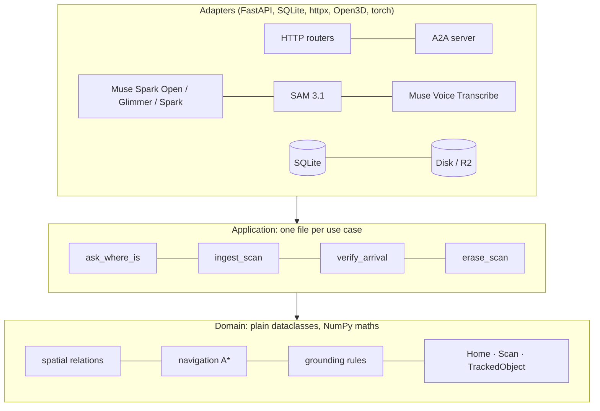
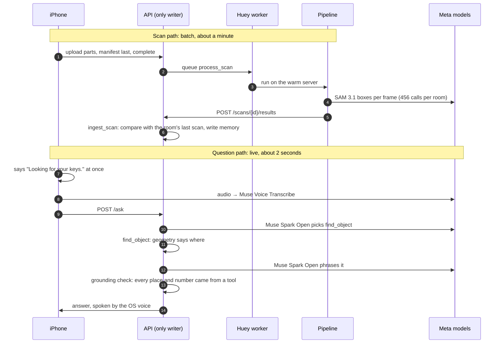
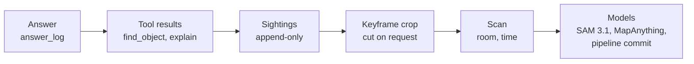

# Recall architecture

Recall turns one walk through a room into a memory you can ask by voice: "where are my keys?" → "near the desk in the
living room, at waist height, seen yesterday at 04:21", then step-by-step directions. This page explains how it is
built and **why each part is the way it is**. The decisions behind it, with what was rejected, are in
[decisions.md](decisions.md). Privacy is in [privacy.md](privacy.md).

Two rules shape everything:

1. **Geometry decides facts; the model only phrases them.** A place, height, distance or time comes from the 3D scan
   and the tools, never from a language model's guess, and code checks every answer
   (`services/api/src/recall_api/domain/assistant/grounding.py`).
2. **Only what a decision needs.** No streaming platform, message broker, vector database, data mesh or multi-region
   setup: none of Recall's decisions needs them, and complexity isn't a feature.

## The six layers

```mermaid
flowchart LR
  subgraph Source["1 · Source (iPhone)"]
    cam[Camera frames]
    lidar[LiDAR depth + confidence]
    pose[ARKit poses + tracking state]
    mic[Voice question]
  end
  subgraph Ingest["2 · Ingest"]
    up["Resumable multipart upload<br/>sha256 per part, manifest last<br/>upload_scan.py"]
  end
  subgraph Store["3 · Store (your Mac)"]
    raw["Raw episodes, never edited<br/>data/blobs/scans/…/episode"]
    stage["Stage outputs<br/>result.json, home_cloud.npy"]
    mem["Memory: SQLite<br/>homes, scans, objects, sightings, audit"]
  end
  subgraph Transform["4 · Transform"]
    q["Huey queue on SQLite<br/>one job at a time"]
    pipe["Pipeline: MapAnything or LiDAR depth → planes →<br/>SAM 3.1 boxes → lift → cluster → room model"]
  end
  subgraph Serve["5 · Serve"]
    api["API (FastAPI): ask, guidance, verify,<br/>objects, room, privacy, audit"]
    a2a["Home Memory agent (A2A 1.0)"]
    robot["Robot export (Nav2 map)"]
  end
  subgraph Consume["6 · Consume"]
    phone[iPhone app]
    watch["Apple Watch (next)"]
    web[Website + viewer]
    bots[Robots and agents]
  end
  Source --> Ingest --> Store --> Transform --> Store
  Store --> Serve --> Consume
  Cross["Across every layer: privacy and home scoping · lineage · quality checks · spend limits"]
```

| Layer | What it is | Why this, not something bigger | Code |
|---|---|---|---|
| Source | Our own `ARSession`: frames (long edge ~1024 px), 16-bit LiDAR depth, ARKit confidence, camera-to-world poses, voice | Plain ARKit, no Apple room scanning or plane classification: those are Apple models, and only Meta models may run (rule 8) | `apps/ios/Packages/RecallKit/Sources/RecallCapture` |
| Ingest | One episode = one zip, uploaded in ~8 MB parts by background `URLSession`; each part checksummed; `manifest.json` last; the phone makes the scan id, so retries are idempotent | A home Wi-Fi drops; a resumable upload survives that without a streaming system | `services/api/src/recall_api/application/upload_scan.py` |
| Store | Raw episodes on the Mac's disk (an R2 adapter exists); stage outputs beside them; memory in one SQLite file (140 KB for a scanned room) | One household, one writer, kilobytes of memory: SQLite is the right size, and it's one file to back up or erase | `adapters/outbound/storage`, `adapters/outbound/persistence/sqlite.py` |
| Transform | A Huey queue on SQLite runs one pipeline job at a time; a warm server keeps MapAnything loaded; SAM answers are cached per scan | One GPU, one job at a time; Huey needs no extra server (Celery needs Redis, Prefect a server and UI) | `services/api/src/recall_api/infra/jobs.py`, `services/pipeline` |
| Serve | One FastAPI app: the phone's API, the A2A Home Memory agent (off by default), the robot export, `/privacy` | One process; A2A is mounted inside it, not a separate service | `services/api/src/recall_api/infra/app.py` |
| Consume | The iPhone app (VoiceOver first), the website and viewer, robots and other agents with their own read-only key | Each client gets only what it needs: robots never get photos, names or notes | `apps/ios`, `apps/web`, `examples/` |

**Across every layer:**
- **Privacy and home scoping:** the memory stays on the owner's Mac. Every request needs the device key, and robots
  have their own read-only key. Deleting a scan erases it from the Mac too.
- **Lineage:** every answer leads back through its tool results to the sightings, keyframe crops, scans and model
  versions behind it (see below).
- **Quality checks:** blur is checked on the phone and again in the pipeline. Contract tests check the spec, a
  synthetic room runs through the pipeline, and a nightly job re-runs every scan.
- **Spend limits:** the website's voice route is rate-limited.

## Hexagonal inside each service

import-linter enforces the arrows in CI: the domain and application never import FastAPI, SQLAlchemy, httpx,
OpenAI, torch or boto3 (`services/api/pyproject.toml`). Swapping Baseten for LM Studio or the disk for R2 is a
change in `infra/container.py`, driven by config.

## The two paths

The pipeline never touches the database; it posts its result and `ingest_scan` writes. One writer means one place for
the invariants (what moved, what is gone, what the user corrected), and torch never enters the API.

## Every answer is traceable

Each answer is logged with:
- every model step and tool step, with timings and outputs;
- the sightings it rests on;
- the model and the tokens used.

Sightings are never edited. When a thing moves or is gone, an append-only "set aside" record says so, and "where it
is now" is derived from the two (`domain/memory/model.py`). Database triggers refuse updates to sightings, set-asides
and the answer log (`db/migrations/versions/0007_sighting_log.py`).

There are three ways to follow the chain:
- `GET /answers/{id}/evidence` returns all of it.
- The phone's **Why?** button reads it aloud.
- Asked "why do you think so?", the Guide answers from the same chain with its `explain` tool.

Two rules hold it together:
- An answer that names a place with no sighting behind it is never said.
- Erasing a scan for privacy is the one deletion. It removes the scan's sightings and the set-asides that scan
  decided, so the earlier memory comes back by itself.

## Latency tiers

| Tier | What | Target | Measured | How |
|---|---|---|---|---|
| On device | Guidance steps while walking (pose → next clock-face step) | < 100 ms | `TODO(verify)`: measure on the iPhone | `RecallDomain/Guidance` |
| Interactive | Question → first spoken words | < 2 s | Acknowledgement immediate (system voice); Guide answer p50 **2.3 s**, p90 **2.7 s** (10 real questions, Oct 31) | `scripts/guide_latency.py`, [verification](verification.md) |
| Interactive | Arrival check (photo → confirmed) | < 6 s | **4.9 s** on the real keys frame | `application/verify_arrival.py` |
| Batch | Scan processing per room | minutes | **60 s** with the warm server (MapAnything ~20 s on the M5 Pro's GPU); LiDAR-only reconstruction **0.2 s** | `infra/jobs.py`, ADR D-17 |
| Batch | Nightly regression of every stored scan | overnight | 03:17, cached SAM answers, no model calls | `infra/jobs.py` |

**No streaming infrastructure: no decision needs it.** Live guidance runs on the phone from its own pose; the Mac is
asked once per question.

## Why this, not that

| Choice | Instead of | Why | Decision |
|---|---|---|---|
| Geometry and tools decide; the LLM phrases | Letting the model infer places from labels (RAG) | A wrong place sends a blind person the wrong way; code checks every answer | [D-02](decisions.md#d-02) |
| MapAnything fed ARKit intrinsics, poses and LiDAR depth | Images-only reconstruction | Images-only came out ~23 % too large; the phone's metric inputs fix scale | [D-08](decisions.md#d-08) |
| A model-free fallback: LiDAR depth back-projected with ARKit poses | VGGT or another model | All 10 objects within 7 cm of MapAnything, in 0.2 s, no GPU | [D-09](decisions.md#d-09) |
| SQLite, one file per home | Postgres | One household, one writer, kilobytes of data; nothing to run | [D-04](decisions.md#d-04) |
| Huey on SQLite | Celery + Redis, Kafka, Prefect | One GPU, one job at a time, retries and a schedule, no extra server | [D-05](decisions.md#d-05) |
| Classic algorithms (RANSAC, DBSCAN, A*, assignment) | More models | Deterministic, testable on synthetic rooms, nothing to host | [D-12](decisions.md#d-12)–[D-15](decisions.md#d-15) |
| Muse Spark Open on Baseten, `reasoning_effort: low` | The default `xhigh`; a closed model | Open weights (the Guide is Meta's open model); the low setting halves the time with the same answers | [D-10](decisions.md#d-10) |
| A2A 1.0 for robots and agents | A custom endpoint | A standard agents already speak; structured input only | [D-20](decisions.md#d-20) |
| Schema validation, then a Meta-model check | A keyword filter alone | Free text never reaches a model or tool; the check is a Meta model and fails closed | [D-21](decisions.md#d-21) |
| OS speech (AVSpeechSynthesizer, Web Speech) | A text-to-speech model | Allowed by the rules, offline, the user's own voice and rate | [D-18](decisions.md#d-18) |
| No vector database | Embedding search over memory | Things are found by label, colour and the user's names; a home holds tens of things, not millions | [D-04](decisions.md#d-04) |
| Hexagonal ports and adapters | A layered monolith | Four model providers and two stores swap by config; the domain is tested without network or torch | [D-01](decisions.md#d-01) |

## Anti-pattern check

| Anti-pattern | Why Recall avoids it | Proof |
|---|---|---|
| Data swamp | Every episode has a versioned format (`recall-episode/1`), a manifest with a sha256 per file, and every stage output is validated against the spec | `services/api/resources/schemas/ScanResult.yaml`, `application/upload_scan.py` |
| Distributed monolith | Two services, one contract (`POST /scans/{id}/results`), one writer; the pipeline never opens the database | `services/pipeline/src/recall_pipeline/adapters/api_client.py` |
| Accidental real-time | Scans are batch jobs on a queue; only guidance is live, and it runs on the phone | `services/api/src/recall_api/infra/jobs.py` |
| Premature mesh | One API process, one SQLite file, A2A mounted inside the app, not a service per aggregate | `services/api/src/recall_api/infra/app.py` |
| Feedback loops | No model output is written back as a fact: memory comes only from geometry; the Verifier's vision model may only downgrade; the nightly regression compares with the previous geometric run | `application/verify_arrival.py`, `domain/assistant/grounding.py` |

## Questions judges ask

**What does a scan cost?** Measured on the living room (56 frames): **456 SAM 3.1 calls** (19 views × 24 concepts),
119 s of SAM time cold and cached afterwards, MapAnything on the Mac's own GPU, and **48 MB** on disk. Price per SAM
call: `TODO(verify)` from the Meta Model API pricing page.

**What does a question cost?** Measured over 9 recorded questions: **2 Muse Spark Open calls**, median **2,460
prompt and 261 completion tokens**. Asking by voice adds 1 Muse Voice Transcribe call. An arrival check is 1 SAM 3.1
call, plus 1 Muse Spark 1.1 call only when SAM is unsure. Baseten's price per token: `TODO(verify)`.

**Where does the data live, and who can read it?** On the owner's Mac. Scan photos go to SAM 3.1 and voice to Muse
Voice Transcribe on the Meta Model API. Questions, with no photos, go to Muse Spark Open on Baseten, or stay on the
Mac with Glimmer in LM Studio. Robots get only a map with labels, and only while Robot Access is on.
The whole note: [privacy.md](privacy.md). The phone shows the current answer under Settings → Privacy (`GET /privacy`).

**What changes at 10× rooms?** Processing grows linearly: about 1 minute and 456 SAM calls per room, run one at a
time overnight if needed. Storage grows by about 48 MB per room, while the memory database stays in kilobytes. Asking
is unchanged: `find_object` reads one home's things, tens to hundreds of rows.

**What changes at 10× homes?** Nothing on any one Mac: each home is its own install, so there is no shared server to
scale. A hosted, multi-home version would need:
- home scoping in every query;
- Postgres instead of SQLite;
- the R2 adapter (already there) instead of the disk;
- a GPU worker per region for MapAnything (Modal is the planned route).

The ports make each of those a new adapter, not a rewrite.
